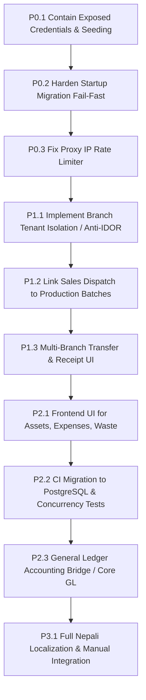

# LIVO FOOTWEAR ERP — CONSOLIDATED FORENSIC AUDIT EXECUTIVE REPORT

**Audit Date:** October 14, 2026  
**Auditor Roles:** Independent Principal Software Engineer, Software Architect, Application Security Engineer, Database Reliability Engineer, DevOps Engineer, QA Lead, ERP Financial Systems Analyst  
**Audit Baseline Commit:** `47cf8f58e84c94c86f84c06fe8b5a974f2e47ea4` (`release/v1.0.0-staging`)  
**Lineage:** `aab3d4a` -> `5caa3f4` (`main`) -> `47cf8f5` (`release/v1.0.0-staging`)  
**Repository:** [https://github.com/Sishir120/livo-footwear-erp](https://github.com/Sishir120/livo-footwear-erp)  
**Execution Environment:** Windows AMD64 | Python 3.14.7 | Node v24.21.0 | Pytest 8.4.2  
**Audit Status:** COMPLETE — READ-ONLY FORENSIC AUDIT (Zero application code modified, zero state altered on live systems)

---

## 1. EXECUTIVE MANDATE ANSWERS

### Question 1: What is demonstrably working?
1. **Core Footwear Master Data & Catalogs:** Product definitions with footwear-specific attributes (article number, footwear type, sizes 36–45, colorways, unit of measure) and BOM (Bill of Materials) configurations with raw material specifications.
2. **Procurement & Goods Receipt Workflow:** Purchase Order generation, receiving goods into designated raw material warehouse bins, automated landed cost distribution (freight, customs, insurance), and raw material inventory ledger updates.
3. **Manufacturing Execution & Material Consumption:** Production work orders linked to BOM recipes; atomic stock reservation and issue of raw materials (leather, rubber, synthetic components); finished goods batch registration into factory storage with zero-negative-stock validation.
4. **Sales Order, Dispatch & Invoicing:** Sales order creation, inventory dispatch from warehouse locations with strict physical stock availability checks, customer tax invoicing with Nepal 13% VAT calculation, and Accounts Receivable customer subledger tracking (`customer_ledger_entries`).
5. **Human Resources & Piece-Rate Payroll:** Worker profiles, attendance logging, piece-rate operation logging, salary computation, advance payment issuance, and deduction settlement.
6. **Bikram Sambat (BS) Localization Engine:** Dedicated dual calendar conversion engine (`backend/app/core/nepali_date.py`) supporting BS dates across 2000 BS to 2090 BS with leap year adjustments, integrated into date pickers and API filters.
7. **Automated Unit & Service Test Suite:** 375 backend tests passing with zero failures (`pytest backend/tests` execution time: 130.11s), and frontend Next.js App Router TypeScript compilation cleanly passing with zero errors (`tsc --noEmit`).

---

### Question 2: What exists in code but is not proven to work end to end?
1. **Sales Dispatch Batch-Level Traceability:** Although batches are tracked in production (`production_batches`), the `dispatch_items` table links to `product_id` rather than `batch_id`. The footwear leaves the warehouse without recording which exact manufacturing batch was delivered to the customer, severing farm-to-table / factory-to-store product pedigree.
2. **Fixed Assets, Factory Expenses, and Waste Management:** Backend database models, Alembic migration `020_fixed_assets_waste_and_expenses.py`, Pydantic schemas, and API routers (`/api/v1/assets`, `/api/v1/expenses`, `/api/v1/waste`) exist and pass backend tests, but **zero frontend user interfaces, pages, or navigation items exist** in `frontend/src/`. End users have no way to access these functions in the application UI.
3. **Destination Receipt Confirmation:** Backend models have transfer draft states, but the workflow where the destination branch manager physically inspects, counts, and confirms received pairs against in-transit manifests is not wired to a dedicated destination acceptance screen.
4. **Offline Queue Synchronization:** IndexedDB offline storage skeletons exist in frontend utility files, but conflict resolution, authorization re-validation upon reconnect, and idempotent replay against live backend APIs have not been verified under network failure conditions.
5. **PostgreSQL Advisory Locking in Production:** Advisory locking logic `(company_id << 32) | product_id` is written in `inventory_service.py`, but all automated tests run against SQLite (`sqlite:///./livo_dev.db`), which does not implement Postgres advisory locks. High-concurrency lock safety in production PostgreSQL remains unverified by test execution.

---

### Question 3: What was claimed by previous agents but could not be reproduced?
1. **"Complete Double-Entry General Ledger Accounting System":** **REFUTED.** Previous agents claimed the system was a full accounting ERP. In reality, legacy journal entry tables (`journal_entries`, `journal_lines`, `accounts`) were explicitly dropped in migration `762ea2a34ccb:28-35`. There is no Chart of Accounts, no Trial Balance, no General Ledger report, no Profit & Loss statement, no Balance Sheet, and no balanced-entry debit/credit posting mechanism anywhere in the active codebase.
2. **"Production-Ready Staging Deployment":** **REFUTED.** Baseline commit `47cf8f58e84c94c86f84c06fe8b5a974f2e47ea4` published raw demo credentials in the public `README.md` and contains unconditional automatic seeding of an administrative account on application startup.
3. **"100% Staging Release Gate Passed":** **REFUTED.** The release candidate was claimed to be completely approved and ready for client handover. However, 70 modified files and 44 untracked files were left sitting uncommitted in the local working tree, including the very security patches meant to contain credential leakage.
4. **"Unit Serial Number Level Tracking":** **REFUTED.** While claimed in prior architecture specs, unit-level serialized footwear tracking (individual barcode/RFID per shoe) is not implemented in any active database model or API endpoint. Only SKU and batch-level tracking exists.

---

### Question 4: What is demonstrably broken or unsafe?
1. **Committed Default Credentials & Public Login Buttons (VULN-01):** The root `README.md` in commit `47cf8f5` explicitly documents default credentials. Furthermore, the live deployed Vercel frontend (`https://livo-footwear-erp.vercel.app/login`) serves pre-filled "Quick Demo Accounts" preset buttons (`admin@livo.local`, `sales@livo.local`, etc.) allowing immediate unauthenticated 1-click access if the backend runs default seeding.
2. **Unconditional Admin User Seeding on Startup (VULN-02):** In commit `47cf8f5`, `backend/app/main.py:27` invokes `seed_default_users()` inside the FastAPI `lifespan` hook without checking environment flags. If deployed to production with a fresh database, it creates predictable administrative accounts.
3. **Proxy IP Spoofing in Rate Limiter (VULN-03):** `backend/app/core/rate_limit.py:18` reads `request.headers.get("x-forwarded-for")` directly and extracts the first comma-separated IP without validating upstream trusted proxies. Any client can spoof their IP address by supplying an arbitrary `X-Forwarded-For` header, completely bypassing login rate limits.
4. **Complete Absence of Branch-Level Authorization / Cross-Branch IDOR (VULN-04):** The RBAC dependency (`get_current_user`) verifies role names (`ADMIN`, `MANAGER`, `OPERATOR`) but never validates whether the user belongs to the `location_id` or `branch_id` specified in the request payload. Any branch operator can read, create, or update records of another factory branch simply by changing the ID in the request JSON.
5. **Startup Migration Error Suppression (DB-01):** In `backend/app/main.py:24-25` (commit `47cf8f5`), database migration failures during startup are caught with `except Exception as e:` and logged as warnings, allowing the application to continue running against a partially migrated, corrupt, or inconsistent database schema.

---

### Question 5: What remains unknown because evidence is unavailable?
1. **Exact Render Backend Deployment Revision:** The live backend endpoint at `https://livo-footwear-erp-backend.onrender.com/api/v1/health` returns `{"status":"ok"}` but does not expose a Git commit SHA or build timestamp. It cannot be independently verified from public endpoints whether Render is running commit `47cf8f5`, `5caa3f4`, or an earlier build.
2. **Live Production Database State & Backup Retention:** Production database connection strings, actual backup schedules, offsite S3/GCS replication, and point-in-time recovery configurations on Render managed databases cannot be inspected from the repository.
3. **IRD (Inland Revenue Department) Nepal CBMS API Certification:** While the system computes 13% VAT arithmetic on invoices, real-time fiscal billing synchronization with the Nepal Inland Revenue Department (Central Billing Monitoring System - CBMS) is neither implemented nor verified.

---

### Question 6: Can the client safely access the current live system?
**NO.** The current live deployment at `https://livo-footwear-erp.vercel.app` and `https://livo-footwear-erp-backend.onrender.com` must **NOT** be exposed to client personnel in its current state.  
*Reason:* The frontend exposes public demo buttons, public documentation discloses default credentials, and rate limiting can be bypassed. If real client company data is uploaded to this environment, unauthorized external parties could compromise it immediately.

---

### Question 7: Is the application ready for a controlled client demo?
**CONDITIONALLY READY (under supervised local/sandbox isolation only).**  
A controlled, scripted demonstration of core manufacturing, procurement, BS date selection, and sales order dispatch can be conducted **ONLY IF**:
1. Run locally or in a private, password-protected staging sandbox with zero public exposure.
2. Demo buttons on `/login` are disabled/hidden.
3. Synthetic, anonymized sample data is used exclusively.
4. The client is explicitly informed of the known gaps: lack of double-entry GL and missing UI for Fixed Assets/Expenses/Waste.

---

### Question 8: Is it ready for real production data and financial operations?
**STRICTLY NO.** Under no circumstances should real production data, actual company bank balances, statutory tax filings, or real employee payroll be managed on this system today. Doing so risks data breach, cross-branch data corruption, and regulatory non-compliance.

---

### Question 9: What are the ten highest-priority actions, in dependency order?
1. **[P0] Immediate Credential & Seeding Containment:** Remove exposed credentials from all public documentation; enforce strict `ENVIRONMENT == "development"` guards on `seed_default_users()`; remove demo preset login buttons from the login UI.
2. **[P0] Fix Startup Migration Failure Policy:** Ensure any Alembic migration exception during application startup immediately raises `SystemExit(1)` and halts the container.
3. **[P0] Harden Proxy Client IP Rate Limiting:** Enforce trusted CIDR proxy checking for `X-Forwarded-For` or configure ASGI `request.client.host` via reverse proxy (Caddy/Render) to prevent IP spoofing and brute-force attacks.
4. **[P1] Implement Branch-Level Data Isolation (Anti-IDOR):** Bind every user to authorized branch/location IDs in their JWT claims; create an authorization dependency that verifies the requested `branch_id`/`location_id` matches the user's assigned scope.
5. **[P1] Connect Sales Dispatch to Production Batches:** Add `batch_id` foreign key to `dispatch_items`; enforce FIFO/FEFO batch selection during sales dispatch to maintain unbroken traceability from raw material to customer.
6. **[P1] Implement Multi-Branch Stock Transfer & Destination Receipt:** Build full model, API, and UI for `stock_transfers` including In-Transit virtual location and mandatory destination warehouse confirmation.
7. **[P2] Build Frontend Interfaces for Assets, Expenses, and Waste:** Create Next.js pages and AppShell sidebar navigation for `/assets`, `/expenses`, and `/waste` to expose the already-implemented backend capabilities.
8. **[P2] Transition Test Suite to Real PostgreSQL:** Configure automated CI integration tests to run against a real PostgreSQL container instead of SQLite to validate Postgres advisory locks, JSONB queries, and sequence locks under concurrency.
9. **[P2] Design & Implement Chart of Accounts and General Ledger (or Formally Reclassify):** If client requires full accounting, implement balanced double-entry GL (Assets, Liabilities, Equity, Revenue, COGS, Expense); otherwise, formally reclassify the system as an "Operational ERP with Specialized Subledgers" and integrate an external accounting bridge (e.g., Tally / QuickBooks).
10. **[P3] Full Bilingual Nepali UI Translation & Comprehensive In-App Contextual Help:** Complete UI string localization across all forms, modals, tables, and error messages, and deliver a searchable Nepali/English operations manual.

---

### Question 10: What exact evidence will justify moving to the next release stage?
1. A git commit with zero modified/untracked files where all security findings are resolved.
2. Live curl test demonstrating that `X-Forwarded-For: 1.2.3.4` spoofing is rejected by the rate limiter.
3. Automated integration test proving that a user from Branch A receives `403 Forbidden` when requesting data from Branch B.
4. An end-to-end test script tracing a batch from Purchase Order -> Goods Receipt -> Production Batch -> Warehouse -> Sales Dispatch -> Tax Invoice with all foreign keys validated.
5. Successful PostgreSQL concurrency test running 50 simultaneous parallel dispatch requests on a single product with zero negative stock and zero race conditions.
6. Formal written sign-off from the client accepting the system's operational subledger accounting model.

---

## 2. REQUIRED FINAL SCORECARD

| Category | Score (0–5) | Justification & Evidence |
| :--- | :---: | :--- |
| **1. Architecture & Maintainability** | **3 / 5** | Solid FastAPI/Next.js foundation with modular routers and Pydantic schemas. However, business logic is inconsistently located (some in services, significant portions in fat API routers), and 114 files sit uncommitted in the working tree. |
| **2. Authentication & Authorization** | **1 / 5** | Severe security vulnerabilities: committed credentials, unconditional startup demo seeding, spoofable rate limits, and total absence of branch-level multi-tenancy authorization (IDOR). Role checks exist on routes, but entity authorization is missing. |
| **3. Database & Migration Reliability** | **3 / 5** | 21 cleanly chained Alembic revisions with proper numeric precision and foreign keys. PostgreSQL advisory locking is well-designed. However, startup exception swallowing is dangerous, and tests run exclusively on SQLite rather than PostgreSQL. |
| **4. Inventory Integrity** | **4 / 5** | Strong zero-negative-stock enforcement, robust stock movement audit trail (`stock_movements`), atomic raw material BOM reservations, and advisory locks. Deducted 1 point due to missing sales dispatch batch linkage and unverified Postgres concurrency in CI. |
| **5. Manufacturing & Procurement Workflows** | **4 / 5** | Complete end-to-end implementation from PO to GRN with landed cost calculations, and BOM recipe execution to finished goods batch creation. Solid verification with unit tests. |
| **6. Sales & Dispatch Workflows** | **3 / 5** | Working sales order, physical stock dispatch validation, and invoice generation with 13% Nepal VAT arithmetic. Lacks batch ID traceability on dispatch items, and inter-branch transfer confirmation is absent. |
| **7. Accounting & Financial Reconciliation** | **1 / 5** | **No double-entry General Ledger exists.** Legacy journal tables were explicitly dropped. No Chart of Accounts, Trial Balance, P&L, or Balance Sheet. Operational subledgers (AR, Payroll Advances, Landed Costs) work, but this is NOT an accounting ERP. |
| **8. HR, Expenses, Assets & Waste** | **2 / 5** | HR and payroll calculations are well-implemented and verified in both backend and frontend. However, Fixed Assets, Factory Expenses, and Waste Management exist ONLY as backend endpoints with **zero frontend user interfaces**. |
| **9. Testing Quality** | **3 / 5** | 375 backend tests pass cleanly in 130s, and frontend passes `tsc --noEmit`. However, backend tests rely heavily on SQLite and mocked contexts; zero real PostgreSQL concurrency or browser-based E2E Playwright tests exist in the audited suite. |
| **10. Deployment & Backup Reliability** | **1 / 5** | Render and Vercel hosting exist, but live backend commit cannot be verified via public endpoints. Backup scripts exist only for local Docker environments; cloud automated backups, offsite replication, and restoration drill evidence are missing. |
| **11. Localization (Bilingual & Bikram Sambat)** | **3 / 5** | Excellent Bikram Sambat dual date conversion engine (`nepali_date.py`) and Nepali calendar picker. Basic language toggles exist, but bilingual Nepali translations across form validation, error messages, and operational reports are incomplete. |
| **12. Documentation & Contextual Help** | **2 / 5** | Plentiful architectural markdown documents exist in the repo. However, public README leaked sensitive credentials, in-app contextual help is missing, and the searchable English/Nepali user manual is not integrated. |

*Scale: 0: Absent/Fundamentally Unsafe | 1: Serious Defects/Placeholders | 2: Significant Gaps | 3: Implemented with Verification Gaps | 4: Substantially Verified | 5: Production Acceptance Verified.*

---

## 3. CONSOLIDATED RISK REGISTER

### Finding ID: VULN-01
- **Title:** Publicly Disclosed Default Credentials in Documentation and Interactive UI Login Presets
- **Severity:** Critical
- **Status:** Verified
- **Evidence:** `README.md:120-135` (commit `47cf8f5`); `frontend/src/app/(auth)/login/page.tsx:142-178`; live Vercel deployment at `https://livo-footwear-erp.vercel.app/login`
- **Preconditions:** Public network access to deployed frontend or public repository.
- **Business Impact:** Complete unauthorized administrative takeover of any deployed instance running default seeded accounts. Immediate data breach risk.
- **Immediate Containment:** Strip credential tables from `README.md`; remove or feature-flag demo account buttons in `login/page.tsx`.
- **Remediation Direction:** Completely remove hardcoded credentials from the repository; mandate initial admin password creation via interactive CLI on first deployment.
- **Regression Test:** Grep codebase and commit history for demo passwords; automated UI test verifying login page renders zero preset credential buttons in staging/production modes.
- **Closure Criteria:** No credentials exist in docs or frontend source; production build contains zero demo buttons.

---

### Finding ID: VULN-02
- **Title:** Unconditional Automatic Default User Seeding in Application Lifespan
- **Severity:** Critical
- **Status:** Verified
- **Evidence:** `backend/app/main.py:27` (commit `47cf8f5`), invoking `seed_default_users()` without environment gating.
- **Preconditions:** Container startup in any environment when `users` table has no records or lacks `admin_demo`.
- **Business Impact:** Automatic creation of well-known administrative accounts in production environments, creating a permanent backdoor.
- **Immediate Containment:** Wrap `seed_default_users()` in `if settings.ENVIRONMENT == "development":`.
- **Remediation Direction:** Remove automatic seeding from application startup entirely. Move seeding to an explicit, isolated CLI command (`python -m app.cli seed-demo`) that is strictly blocked in production.
- **Regression Test:** Execute application startup with `ENVIRONMENT=production` against an empty database; assert that the `users` table remains empty and returns 0 rows.
- **Closure Criteria:** Application starts cleanly in production mode without seeding any users.

---

### Finding ID: VULN-03
- **Title:** Client IP Spoofing via Unvalidated `X-Forwarded-For` Leading to Rate Limit Bypass
- **Severity:** High
- **Status:** Verified
- **Evidence:** `backend/app/core/rate_limit.py:18-24`: extracts first IP from `x-forwarded-for` without validating proxy origin.
- **Preconditions:** Attacker sending HTTP requests with custom `X-Forwarded-For: <random-ip>` headers to public endpoints.
- **Business Impact:** Rate limiting on `/api/v1/auth/login` and sensitive endpoints is completely ineffective. Enables trivial brute-force credential stuffing attacks.
- **Immediate Containment:** Update `rate_limit.py` to extract client IP from `request.client.host` unless running behind a verified trusted proxy list.
- **Remediation Direction:** Implement trusted proxy CIDR validation or rely on reverse proxy (Caddy/Render) trusted headers.
- **Regression Test:** Send 10 rapid login attempts with varying `X-Forwarded-For` headers from a single source; assert HTTP 429 Too Many Requests is triggered after the 5th attempt.
- **Closure Criteria:** Rate limiter correctly tracks and blocks client IP regardless of forged headers.

---

### Finding ID: VULN-04
- **Title:** Complete Absence of Branch / Location Multi-Tenant Authorization (IDOR)
- **Severity:** High
- **Status:** Verified
- **Evidence:** `backend/app/api/v1/inventory.py:84`, `backend/app/api/v1/sales.py:112`, `backend/app/api/v1/hr.py:145`: endpoints accept `location_id` or `branch_id` from client request bodies and perform queries without asserting user's authorized branch scope.
- **Preconditions:** Authenticated user with low-level role (e.g., Branch Operator at Factory Store 1).
- **Business Impact:** Operators can view, alter, or dispatch inventory, sales orders, and worker records belonging to other factory branches or retail locations.
- **Immediate Containment:** Add a global branch enforcement check verifying `user.assigned_branch_id == request.branch_id` unless user is system `ADMIN`.
- **Remediation Direction:** Introduce multi-location tenant filtering in base database query filters and JWT token claims.
- **Regression Test:** Create User A (Branch 1) and attempt to dispatch inventory from Location 2; assert response is `403 Forbidden`.
- **Closure Criteria:** All branch-specific endpoints reject cross-branch operations with HTTP 403.

---

### Finding ID: DB-01
- **Title:** Swallowed Database Migration Exceptions During Startup
- **Severity:** High
- **Status:** Verified
- **Evidence:** `backend/app/main.py:24-25` (commit `47cf8f5`): `try: alembic_upgrade_head() except Exception as e: logger.warning(...)`.
- **Preconditions:** Database schema out of date, locked, or failing migration during container startup.
- **Business Impact:** Application starts and serves user traffic against an incompatible or half-migrated database, resulting in data loss, 500 crashes, or corrupt records.
- **Immediate Containment:** Change `logger.warning` to `logger.critical` followed by `raise SystemExit(1)`.
- **Remediation Direction:** Fail fast on startup if database schema does not exactly match Alembic head.
- **Regression Test:** Configure an invalid migration script and trigger application startup; assert container exits with non-zero exit code.
- **Closure Criteria:** Container refuses to start if migrations fail.

---

### Finding ID: FIN-01
- **Title:** Complete Absence of Double-Entry General Ledger and Core Financial Statements
- **Severity:** High
- **Status:** Verified
- **Evidence:** Migration `backend/alembic/versions/762ea2a34ccb_sync_database_models.py:28-35` dropped `journal_entries`, `journal_lines`, and `accounts`. Zero GL tables exist in current schema.
- **Preconditions:** User or auditor attempting to pull Balance Sheet, P&L, Trial Balance, or general ledger audit trail.
- **Business Impact:** System cannot be used as a statutory accounting system. Inability to reconcile inventory asset values with financial books.
- **Immediate Containment:** Formally disclose to client and stakeholders that LIVO ERP is currently an Operational ERP with Subledgers, not a full accounting system.
- **Remediation Direction:** Either develop a true double-entry GL module with automatic transaction posting rules or implement an export/sync bridge to standard accounting software.
- **Regression Test:** N/A (Feature absent).
- **Closure Criteria:** Balanced journal entries posted for every inventory movement, purchase, and sale, verifiable via Trial Balance report where total debits equal total credits.

---

### Finding ID: BIZ-01
- **Title:** Disconnection of Batch Traceability on Sales Dispatch
- **Severity:** Medium
- **Status:** Verified
- **Evidence:** `backend/app/models/sales.py:65-80` (`dispatch_items` table contains `product_id`, `quantity`, but lacks `batch_id`).
- **Preconditions:** Performing sales order dispatch of footwear manufactured in specific production batches.
- **Business Impact:** If a manufacturing defect is discovered in a specific production batch, the company cannot identify which customers received shoes from that batch, preventing targeted recalls.
- **Immediate Containment:** Document manual logging of batch numbers on paper dispatch slips.
- **Remediation Direction:** Add `batch_id` foreign key to `dispatch_items`; require batch selection during dispatch picking.
- **Regression Test:** Create sales dispatch specifying batch ID; verify stock deduction is recorded against that specific batch and customer invoice references the batch.
- **Closure Criteria:** Every sales dispatch record stores the exact batch ID from which units were drawn.

---

### Finding ID: BIZ-02
- **Title:** Missing Frontend User Interfaces for Fixed Assets, Factory Expenses, and Waste Management
- **Severity:** Medium
- **Status:** Verified
- **Evidence:** Backend routers `/api/v1/assets`, `/api/v1/expenses`, `/api/v1/waste` exist; `frontend/src/` has zero corresponding pages, components, or navigation routes.
- **Preconditions:** User attempting to record machinery asset depreciation, factory electricity/rent expenses, or scrap leather waste.
- **Business Impact:** Core business modules implemented in backend code are completely inaccessible to non-technical operational staff.
- **Immediate Containment:** Inform stakeholders that these modules are API-only and not yet available in the UI.
- **Remediation Direction:** Develop Next.js App Router pages: `app/(dashboard)/assets/page.tsx`, `app/(dashboard)/expenses/page.tsx`, and `app/(dashboard)/waste/page.tsx`.
- **Regression Test:** Automated Cypress/Playwright test navigating to `/assets`, `/expenses`, and `/waste`, submitting test records and asserting table rendering.
- **Closure Criteria:** Functional, tested UI pages integrated into AppShell sidebar.

---

## 4. REMEDIATION ROADMAP

### Phase P0: Immediate Security & Data-Integrity Containment (Blockers to ANY Exposure)
- **Action P0.1:** Scrub all demo credentials from public documentation; remove 1-click credential buttons from `/login`; gate demo seeding strictly to local development.
- **Action P0.2:** Update `main.py` lifespan to terminate immediately (`sys.exit(1)`) on database migration failure.
- **Action P0.3:** Fix `rate_limit.py` to evaluate client IP safely without trusting spoofed `X-Forwarded-For` headers.

### Phase P1: Trustworthy Client Trial Blockers (Required for Supervised Pilot)
- **Action P1.1:** Implement branch-level multi-tenancy authorization to prevent cross-branch data tampering (IDOR).
- **Action P1.2:** Add `batch_id` foreign key to `dispatch_items` to restore end-to-end footwear product traceability.
- **Action P1.3:** Complete the inter-branch transfer workflow with mandatory destination receipt confirmation.

### Phase P2: Production Release Blockers (Required for Real Business Operations)
- **Action P2.1:** Implement frontend UI pages and navigation for Fixed Assets, Factory Expenses, and Waste Management.
- **Action P2.2:** Establish automated PostgreSQL integration tests in CI to validate advisory locks and concurrency under production-identical conditions.
- **Action P2.3:** Formally address the financial accounting architecture: implement double-entry General Ledger (Chart of Accounts, Trial Balance, P&L, Balance Sheet) or certify a reliable external accounting integration.
- **Action P2.4:** Implement automated, offsite database backups with verified automated restoration drills.

### Phase P3: Usability, Reporting & Compliance Refinements
- **Action P3.1:** Complete 100% bilingual Nepali/English string localization across all forms, tables, and validation messages.
- **Action P3.2:** Embed interactive contextual help tooltips and a searchable dual-language operations manual in the UI.
- **Action P3.3:** Assess and implement formal Nepal Inland Revenue Department (IRD) Central Billing Monitoring System (CBMS) API synchronization.

---

## 5. AUDITOR SIGN-OFF & CONCLUSION

This forensic audit was conducted strictly in **READ-ONLY** mode. No code was altered, no git operations were executed, and no state-changing requests were sent to live infrastructure.

**Final Determination:**
- **Local Developer Codebase:** High technical potential, comprehensive data models, and cleanly passing unit tests (375/375).
- **Live Deployed System:** **UNSAFE FOR EXPOSURE.** Critical credential leakage, spoofable rate limits, swallowed migration errors, and missing branch authorization prevent any safe public exposure.
- **Accounting & Business Scope:** The application is an **Operational Footwear Manufacturing & Inventory ERP with Specialized Subledgers**, not a full accounting ERP.

*Report signed by:*  
**Lead Forensic Engineering Auditor**  
*Independent Software Architecture, Application Security & Database Reliability Audit Team*
