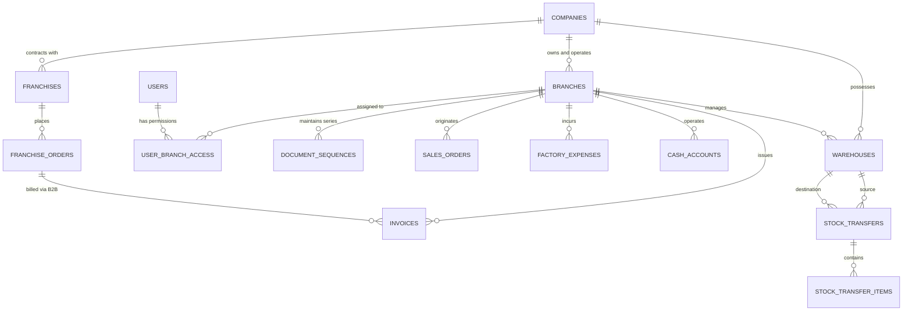

# LIVO FOOTWEAR ERP — BRANCH & FRANCHISE FINANCIAL ACCOUNTING ARCHITECTURE & DISCOVERY

**Document Status:** ARCHITECTURAL SPECIFICATION & DISCOVERY BLUEPRINT  
**Version:** 1.0.0  
**Date:** October 2026  
**Target Systems:** LIVO Footwear ERP Backend (FastAPI/SQLAlchemy), Frontend (Next.js/React), PostgreSQL  
**Statutory Context:** Nepal Companies Act 2063, Value Added Tax Act 2052, Income Tax Act 2058  

---

## 1. EXECUTIVE SUMMARY & ARCHITECTURAL INTENT

The initial design of LIVO Footwear ERP assumed a single-company operating model with multiple physical warehouses (`warehouse_id`) sharing a unified general ledger, single tax registration (PAN/VAT placeholder: `[COMPANY_LEGAL_PAN]`), and centralized accounts receivable/payable ledgers.

As LIVO Footwear expands retail operations and independent distribution partnerships across Nepal (e.g., Regional Showrooms, Central Factory Outlets, Regional Wholesale Hubs, and Independent Franchisees), the business requires **multi-tier organizational and financial boundaries**.

This discovery document defines the complete domain model, entity relationship architecture, authorization models, inter-entity transfer workflows, consolidated financial reporting, and phased zero-downtime migration strategy.

> [!IMPORTANT]
> **Key Architecture Decision (ADR-001):** Operational locations are NOT automatically financial entities.
> - A **Warehouse** is a physical storage & fulfillment location (Inventory ledger node).
> - A **Branch** is an internal operational and financial cost/profit center belonging to the *same* legal parent entity.
> - A **Franchise** is an independent legal entity operating under brand licensing with distinct ownership, distinct PAN/VAT registration, and separate statutory books.

---

## 2. DOMAIN MODEL & ENTITY TYPOLOGY

```
+-----------------------------------------------------------------------------------+
|                                  LEGAL ENTITY                                     |
|                      ([COMPANY_LEGAL_NAME] - PAN: [COMPANY_PAN])                  |
+-----------------------------------------------------------------------------------+
        |                                                              |
        | (Owned Operating Units)                                      | (Commercial Contract)
        v                                                              v
+-----------------------------+                               +-----------------------------+
|      INTERNAL BRANCHES      |                               |    FRANCHISE PARTNERS       |
| (Same PAN, Distinct Unit)   |                               | (Separate Legal Entity/PAN) |
| - Kathmandu Main Showroom   |                               | - Franchise Partner Entity A|
| - Lalitpur Factory Outlet   |                               | - Franchise Partner Entity B|
+-----------------------------+                               +-----------------------------+
        |                                                              |
        | Controls                                                     | Has Own
        v                                                              v
+-----------------------------+                               +-----------------------------+
|    OPERATIONAL WAREHOUSES   |                               |     FRANCHISE WAREHOUSES    |
| - Raw Materials Godown      |                               | - Franchise Local Stock     |
| - Finished Goods Central    |                               +-----------------------------+
| - Retail Floor Stock        |
+-----------------------------+
```

### 2.1 Entity Distinctions

| Characteristic | Operational Warehouse | Internal Branch | Franchise Partner |
| :--- | :--- | :--- | :--- |
| **Legal Status** | Storage facility | Division of parent entity | Separate registered entity |
| **PAN / VAT** | Inherits Parent Company | Inherits Parent Company | Independent 9-digit PAN/VAT |
| **Sales Invoicing** | Delivery note / dispatch only | Tax Invoice under Parent PAN with Branch Unit Code | Independent Tax Invoice under Franchise PAN |
| **Financial Ledger** | Sub-ledger (Inventory only) | Divisional Ledger (P&L, Cost Center, Trial Balance) | Standalone General Ledger & AR/AP Ledger |
| **Inventory Ownership** | Parent Company Consignment | Parent Company Asset | Transferred upon Sale/Billed Out |
| **Staff & Payroll** | Parent Factory / Warehouse Staff | Parent Retail Staff (Branch Cost Center) | Franchisee-employed personnel |
| **Bank / Cash Accounts** | Petty cash imprest only | Dedicated Branch Cash Drawer & Till Accounts | Independent Bank Accounts |

---

## 3. PROPOSED ENTITY RELATIONSHIP DIAGRAM (ERD)



### 3.1 Proposed Data Structures

```python
class BranchType(str, Enum):
    HEAD_OFFICE = "HEAD_OFFICE"
    RETAIL_OUTLET = "RETAIL_OUTLET"
    FACTORY_DIRECT = "FACTORY_DIRECT"
    REGIONAL_DISTRIBUTION = "REGIONAL_DISTRIBUTION"

class Branch(Base):
    __tablename__ = "branches"

    id = Column(Integer, primary_key=True, index=True)
    company_id = Column(Integer, ForeignKey("companies.id"), nullable=False, index=True)
    code = Column(String(10), nullable=False, unique=True)  # e.g., "KTM-01", "PKR-01"
    name = Column(String(100), nullable=False)
    type = Column(String(30), default=BranchType.RETAIL_OUTLET, nullable=False)
    address = Column(String(255), nullable=True)
    phone = Column(String(50), nullable=True)
    is_active = Column(Boolean, default=True, nullable=False)
    
    # Financial Controls
    cost_center_code = Column(String(20), nullable=True)
    cash_account_id = Column(Integer, ForeignKey("accounts.id"), nullable=True)
    revenue_account_id = Column(Integer, ForeignKey("accounts.id"), nullable=True)
    
    # Document Series Prefixes (Nepal IRD Compliance)
    invoice_prefix = Column(String(10), nullable=False, default="INV-BR")
    credit_note_prefix = Column(String(10), nullable=False, default="CN-BR")
    
    created_at = Column(DateTime(timezone=True), server_default=func.now())
```

---

## 4. IMPACTED SYSTEMS & AUDIT TRAIL MATRIX

### 4.1 Affected Backend Models & API Routes

| Domain | Current Implementation | Multi-Branch / Franchise Target |
| :--- | :--- | :--- |
| **Invoices** | `company_id` scoped; single sequence `INV-2081/82-XXXX` | Adds `branch_id` nullable (defaults to Head Office). Branch-specific sequence series `INV-KTM-2081-XXXX` registered with IRD. |
| **Sales Orders** | Central order queue | Branch-scoped order entry. POS orders bill to local branch cash drawer. |
| **Stock Ledger** | `warehouse_id` keyed (multi-warehouse already active) | Warehouses linked to `branch_id`. Dispatched transfers credit Source Branch Inventory and debit Inter-Branch In-Transit account. |
| **Expenses** | `FactoryExpense` has optional `branch` string | Migrates to `branch_id` foreign key. Segregates Branch Operating Expenses (Rent, Utilities, Staff allowance) from Central Production Overhead. |
| **Receivables** | Customer balance across whole company | Customer credit limits centralized; aging and collection reporting filterable by issuing branch. |
| **Users / RBAC** | System-wide roles (`admin`, `sales`, `storekeeper`) | Addition of `branch_id` context in JWT claims. Users can have Branch Manager, Branch Cashier, or Multi-Branch Overseer scope. |

---

## 5. INTER-BRANCH & FRANCHISE FINANCIAL FLOWS

### 5.1 Internal Inter-Branch Stock Movement (Same Legal Entity)
When finished footwear moves from the Central Factory (Birgunj) to Kathmandu Retail Outlet:
1. **Tax Status:** NOT a taxable supply (no VAT invoice required; accompanied by Internal Delivery Challan / Transport Memo as per VAT Rules Rule 25).
2. **Stock Accounting:**
   - Birgunj Finished Goods Stock: -100 pairs at Cost (COGS valuation).
   - In-Transit Stock: +100 pairs at Cost.
   - Kathmandu Branch Inventory: +100 pairs upon independent destination receipt.
3. **General Ledger Entries:**
   - Dr. Inventory - Kathmandu Outlet (Asset)
   - Cr. Inventory - Birgunj Factory (Asset)
   - *No revenue or VAT is recognized.*

### 5.2 Franchise Supply (Separate Legal Entity)
When footwear is dispatched to an independent Franchise (e.g., Pokhara Footwear Center):
1. **Commercial Status:** Commercial B2B Sale.
2. **Tax Status:** Tax Invoice issued under Nepal VAT Act Section 14 (13% VAT charged on taxable value).
3. **Accounting Entries (Livo Parent Books):**
   - Dr. Accounts Receivable - Pokhara Franchise (Asset)
   - Cr. Footwear Sales Revenue - Franchise Wholesale (Income)
   - Cr. Output VAT Payable (Liability - 13%)
   - Dr. Cost of Goods Sold (Expense)
   - Cr. Finished Goods Inventory (Asset)

---

## 6. SHARED EXPENSES & ALLOCATION RULES

Common centralized costs (e.g., national advertising campaigns, brand celebrity endorsements, SAP/ERP software licenses, central executive management) cannot be booked solely to the head office without skewing branch profitability:
1. **Direct Branch Expenses:** Directly debited to the branch cost center (e.g., showroom rent, electricity, retail staff overtime).
2. **Allocated Corporate Overheads:** Distributed periodically (monthly) based on one of three auditable allocation bases:
   - **Revenue Proportion:** `% of Total Monthly Sales`.
   - **Volume Proportion:** `% of Total Footwear Pairs Dispatched`.
   - **Headcount Proportion:** `% of Active Retail Floor Personnel`.
3. **Accounting Mechanism:**
   - Dr. Kathmandu Branch Allocated Admin Expense (Division P&L)
   - Cr. Corporate Overhead Clearing Account (Head Office)

---

## 7. CONSOLIDATED COMPANY REPORTING

The financial reporting engine must support a **Dual-Perspective Reporting Engine**:

1. **Divisional (Branch) P&L:**
   - Revenue (Gross Sales - Discounts - Returns)
   - Less: Cost of Goods Sold (at Transfer Valuation)
   - Equals: Gross Margin
   - Less: Direct Branch Selling & Distribution Costs
   - Less: Allocated Corporate Overhead
   - Equals: Net Branch Operating Contribution

2. **Statutory Consolidated Financials (All Branches Combined):**
   - All inter-branch transfers, inter-branch in-transit stocks, and management fee allocations are **automatically eliminated** upon consolidation.
   - Outputs unified Balance Sheet, Income Statement, Cash Flow, and VAT Annex 7/8 for Inland Revenue Department (IRD) submission.

---

## 8. PHASED MIGRATION STRATEGY (ZERO-DOWNTIME)

```
Phase 1: Foundation (COMPLETED in Phase 2)
[Multi-Warehouse Stock Transfers + In-Transit Reconciliation]
      |
      v
Phase 2: Master Data & Scoping (Non-breaking additive schema)
[Create `branches` table, assign default 'HEAD_OFFICE' (ID 1)]
[Backfill existing orders, invoices, and expenses with `branch_id = 1`]
      |
      v
Phase 3: Contextual Authorization & Sequence Assignment
[JWT branch claims, branch-specific document number generators]
      |
      v
Phase 4: Divisional Reporting & Cost Center Allocation
[Divisional P&L reporting, Inter-branch clearing accounts]
```

### 8.1 Risks to Existing Financial Data & Mitigation Controls

| Risk | Consequence | Built-in Mitigation Rule |
| :--- | :--- | :--- |
| **Accidental In-Place Splitting** | Existing unified customer AR balances become orphaned or fragmented. | Customer accounts remain unified at company level; branch tags are transaction-level metadata rather than entity boundaries. |
| **Tax Non-Compliance** | Issuing internal branch transfers as VAT invoices or failing to issue VAT invoices to franchises. | Strict entity separation: Internal transfers produce non-tax Delivery Challans (`DC-`); Franchise dispatches mandate standard Tax Invoices (`INV-`). |
| **Sequence Number Collisions** | Branches generating duplicate invoice numbers. | Compound sequence keys in `document_sequences` table: `(company_id, branch_id, document_type, fiscal_year)`. |
| **Dirty Historical Data** | Null `branch_id` values breaking queries. | Additive migration sets `server_default=1` pointing to the canonical Head Office entity. No legacy record is left unassigned. |

---

## 9. ACCEPTANCE CRITERIA & VERIFICATION TEST PLAN

1. **Master Entity Isolation:** Creation of a new branch does not alter or recompute any existing invoice or accounting entry in Head Office.
2. **Transfer Immutability:** Internal stock transfers between warehouses belonging to different branches do NOT generate tax liabilities or customer AR entries.
3. **Franchise Invoicing:** Franchise orders mandate a valid customer record with PAN validation and produce Schedule-5 compliant 13% VAT records.
4. **Zero Legacy Disruption:** All historical invoices (including 51–54) and sales orders (including 43–46) remain accessible and reconcilable under Head Office scope.

---

## 10. STATUTORY TAX & LEGAL MATTERS (FOR QUALIFIED NEPAL TAX PROFESSIONAL REVIEW)

The technical database and routing design described herein must be cross-checked against formal tax counsel prior to Phase 2 schema deployment:

| Domain | Technical Architecture Decision | Statutory Assumption Requiring CA Review |
| :--- | :--- | :--- |
| **Branch Invoicing Series** | Prefix series `INV-KTM-` or unit code suffix registered in `document_sequences`. | Confirm Inland Revenue Department (IRD) electronic billing approval requirements under VAT Directive 2069 for multi-branch sequential numbering. |
| **Inter-Branch Stock Movement** | Recorded via Delivery Challan (`DC-`) without Output VAT or AR posting. | Confirm whether transport memos between factory and showroom require VCTS (Vehicle and Consignment Tracking System) digital integration with Department of Revenue Investigation (DRI). |
| **Franchise Consignment vs Sale** | Modelled as outright wholesale B2B sale with 13% VAT. | Confirm whether any franchise agreements operate on a pure consignment agency basis (where revenue is recognized only upon sale to end customer). |
| **Corporate Overhead Allocation** | Proportional P&L debit using revenue or pair-volume weighting. | Confirm deductibility of allocated management expenses between branches under Nepal Income Tax Act 2058 Section 21. |
