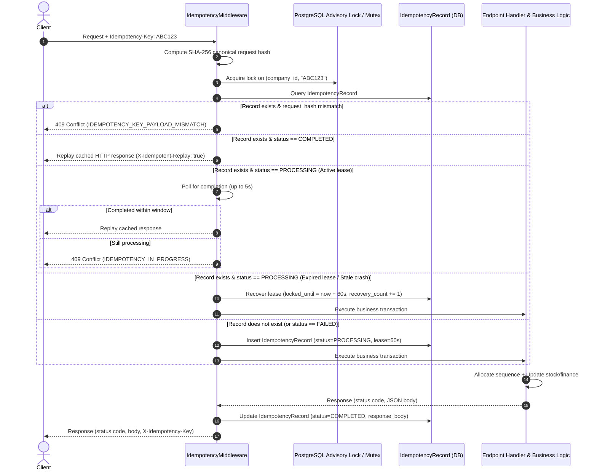

# LIVO Footwear ERP — Idempotency, Duplicate Prevention & Retry Safety Architecture

## 1. Core Principle

A unique document number (e.g., `INV-01-000101` or `SO-2026-00042`) does **not** automatically provide idempotency.

```text
Client sends:
  POST /api/v1/invoices (Order #42)
Server creates:
  INV-01-000101
Network connection drops before client receives HTTP 200.
Client retries:
  POST /api/v1/invoices (Order #42)
Server without idempotency creates:
  INV-01-000102
```

In this scenario, both document numbers are unique, but the statutory tax liability and AR ledger debits have occurred twice.

To ensure **exactly-once business effects**, LIVO Footwear ERP implements:

$$\text{At-Least-Once Network Delivery} + \text{Idempotent Server Processing} = \text{Exactly-Once Business Effect}$$

For every mutating operation:
$$\text{Same Logical Request} + \text{Same Idempotency Key} = \text{Exact Same Business Effect \& Response}$$

---

## 2. System Architecture

The server-side idempotency architecture sits at the core HTTP layer, intercepting all mutating requests (`POST`, `PUT`, `PATCH`, `DELETE`) before they reach route handlers.



---

## 3. Database Model & Schema

Persistence is provided by the `idempotency_records` table, defined in `backend/app/models/idempotency.py` and managed via Alembic migration `010_idempotency_records.py`.

```sql
CREATE TABLE idempotency_records (
    id INTEGER PRIMARY KEY AUTOINCREMENT,
    company_id INTEGER NOT NULL REFERENCES companies(id),
    user_id INTEGER REFERENCES users(id),
    idempotency_key VARCHAR(128) NOT NULL,
    request_method VARCHAR(16) NOT NULL,
    request_path VARCHAR(256) NOT NULL,
    request_hash VARCHAR(64) NOT NULL,
    status VARCHAR(32) NOT NULL DEFAULT 'PROCESSING',
    response_status_code INTEGER,
    response_headers TEXT,
    response_body TEXT,
    resource_id VARCHAR(64),
    resource_type VARCHAR(64),
    error_message TEXT,
    locked_until TIMESTAMP WITH TIME ZONE,
    recovery_count INTEGER NOT NULL DEFAULT 0,
    created_at TIMESTAMP WITH TIME ZONE NOT NULL DEFAULT CURRENT_TIMESTAMP,
    updated_at TIMESTAMP WITH TIME ZONE NOT NULL DEFAULT CURRENT_TIMESTAMP,
    completed_at TIMESTAMP WITH TIME ZONE,
    CONSTRAINT uq_idempotency_company_key UNIQUE (company_id, idempotency_key)
);

CREATE INDEX ix_idempotency_company_key ON idempotency_records (company_id, idempotency_key);
CREATE INDEX ix_idempotency_status_locked ON idempotency_records (status, locked_until);
```

### Multi-Tenant Uniqueness Scoping
Notice that uniqueness is strictly defined on `(company_id, idempotency_key)`.
* Tenant A using key `SO-ORDER-001` and Tenant B using key `SO-ORDER-001` operate with complete independence.
* Tenant A cannot observe, query, or replay Tenant B's cached records.
* The table constraint rejects duplicates within the tenant at the database engine level.

---

## 4. Request Fingerprinting & Conflict Detection

To prevent subtle corruption where a client erroneously reuses an idempotency key for a different business intent, the server computes a canonical SHA-256 fingerprint:

```python
def compute_request_hash(
    method: str,
    path: str,
    body: Optional[bytes | str] = None,
    query_string: Optional[str] = ""
) -> str:
    normalized_body = ""
    if body:
        if isinstance(body, bytes):
            try:
                body_str = body.decode("utf-8")
            except UnicodeDecodeError:
                body_str = None
        else:
            body_str = str(body)

        if body_str:
            try:
                parsed = json.loads(body_str)
                # Canonical JSON: sorted keys, compact separators, normalized types
                normalized_body = json.dumps(parsed, sort_keys=True, separators=(",", ":"))
            except Exception:
                normalized_body = body_str.strip()
        elif isinstance(body, bytes):
            normalized_body = hashlib.sha256(body).hexdigest()

    canonical = f"{method.upper()}:{path}:{query_string or ''}:{normalized_body}"
    return hashlib.sha256(canonical.encode("utf-8")).hexdigest()
```

### Conflict Enforcement Rule
If an incoming request matches an existing `IdempotencyRecord`, but `record.request_hash != incoming_request_hash`, the request is **strictly rejected**:

```json
HTTP/1.1 409 Conflict
Content-Type: application/json

{
  "detail": "Idempotency key 'ABC123' was previously used for a different request payload or endpoint.",
  "code": "IDEMPOTENCY_KEY_PAYLOAD_MISMATCH"
}
```

The server **never** silently executes a new operation under an existing key.

---

## 5. Concurrency Strategy & Thread Safety

Concurrent duplicate requests are handled via a two-tier locking strategy:

1. **Distributed PostgreSQL Advisory Locks**:
   Mapped via signed 64-bit integer hash to `pg_advisory_xact_lock`:
   ```python
   lock_id = hash_args_to_bigint(company_id, idempotency_key)
   db.execute(text("SELECT pg_advisory_xact_lock(:lock_id)"), {"lock_id": lock_id})
   ```
2. **In-Process Thread Mutexes**:
   In SQLite test runners and single-process deployments, an `RLock` keyed by `(company_id, idempotency_key)` serializes threads.

### Async/Sync Threadpool Isolation
To prevent deadlocks between Starlette's async event loop and FastAPI's threadpool worker threads (`anyio.to_thread.run_sync`), the in-process mutex is held **only** during `initiate_or_retrieve` and `record_success` / `record_failure`. The mutex is **released** while `call_next(request)` runs the synchronous business logic.

If 50 concurrent requests hit the server with the identical key:
* Request 1 initiates the record (`status = PROCESSING`).
* Requests 2 through 50 observe `status == PROCESSING` and poll at 50ms intervals.
* As soon as Request 1 finishes and writes `COMPLETED`, Requests 2 through 50 immediately replay the cached response.
* **Result**: Exactly 1 business operation in the database, 0 duplicates.

---

## 6. Stale Processing Lease Recovery

If a worker process crashes, times out, or is forcibly terminated while an idempotency record is in the `PROCESSING` state:

1. Every `PROCESSING` record carries a lease: `locked_until = now() + 60s`.
2. When a subsequent retry arrives:
   ```python
   is_stale = record.locked_until is None or ensure_utc(record.locked_until) < now
   ```
3. If `is_stale == True`:
   * The server detects that the previous worker died before completing.
   * It extends the lease (`locked_until = now() + 60s`), increments `recovery_count += 1`, and permits the retrying client to execute the operation.
   * The key is **never** permanently locked.

---

## 7. Response Replay Contract

When replaying a `COMPLETED` idempotency record, the server reconstructs the exact original business result:

* **HTTP Status Code**: Replayed exactly (e.g. 200 OK, 201 Created, 400 Bad Request, 422 Unprocessable Entity).
* **Response Body**: The exact JSON or text payload returned by the original transaction.
* **Document Number**: Retains original allocated sequence numbers (`INV-01-000101`, `SO-2026-00042`, `RCPT-2026-00015`).
* **Headers**:
  * `X-Idempotent-Replay: true`
  * `X-Idempotency-Key: <key>`
  * `Content-Type: application/json`

---

## 8. Offline Client Synchronization

For factory floor and warehouse environments where network connectivity is intermittent, the frontend outbox (`frontend/src/lib/offlineQueue.ts` and `frontend/src/lib/api.ts`) integrates seamlessly:

1. Every mutating request sent via `apiFetch` generates or retains a stable UUID idempotency key.
2. If offline or if the network drops mid-flight, the transaction is buffered to IndexedDB with that exact key.
3. Upon reconnection, `replayQueue()` dispatches the request with:
   * `Idempotency-Key: <item.id>`
   * `X-Idempotency-Key: <item.id>`
4. If the server had already processed the request prior to the network failure, the server immediately replays the cached 200 response, and the client dequeues the transaction without duplicating stock deductions or invoices.

---

## 9. Retention & Archival Policy

* **Active Window (30 Days)**: All mutating requests retain their idempotency records in hot storage for 30 days, matching the standard monthly accounting and payroll reconciliation cycle.
* **Operational Hot Tier (90 Days)**: High-speed b-tree indexed storage in the primary database.
* **Archival (1 Year)**: Records with associated statutory documents are retained for audit and compliance.
* **Soft-Pruning Safety Rule**: Uncompleted (`PROCESSING`) records are never purged. Deletions are restricted to completed records older than 90 days with permanent audit log references.
