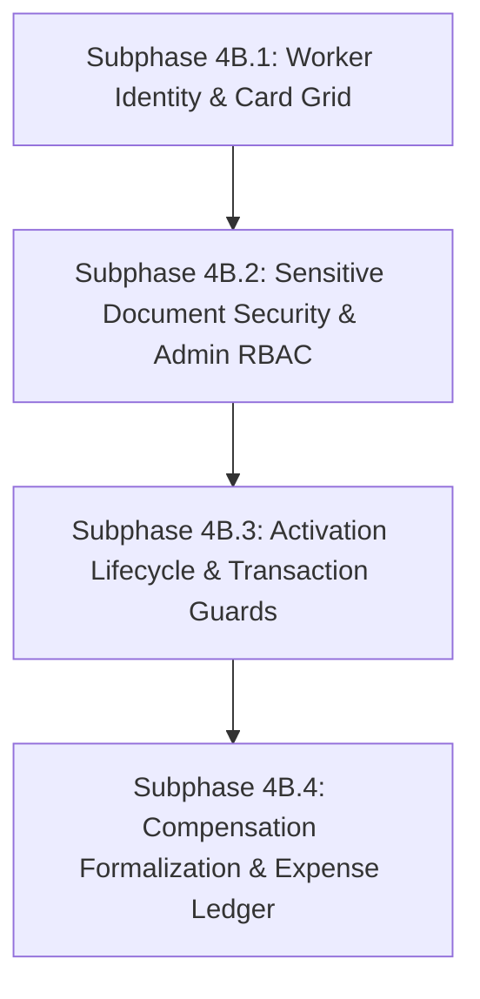

# LIVO FOOTWEAR ERP — PHASE 4B: HR & WORKER MANAGEMENT
## Comprehensive Forensic Audit, Gap Analysis & Implementation Plan

**Audit Execution Date:** 2026-10-12  
**Auditor Roles:** Senior ERP Architect, Backend Security Engineer, Payroll Systems Analyst, Database Engineer, Frontend UX Reviewer  
**Audit Scope:** Read-Only Forensic Analysis of HR-01 through HR-06  
**Repository State:** Clean inspection; Branch `main`, HEAD commit `5caa3f471e92aece268d0fa519a920e7cc7dc512`  

---

### A. Executive Summary

A comprehensive, read-only forensic audit of the LIVO Footwear ERP codebase was conducted to evaluate existing HR and worker-management capabilities against client requirements **HR-01** through **HR-06**.

#### Requirement Status Overview

| Status Category | Count | Requirements |
|---|---|---|
| **VERIFIED_IMPLEMENTED** | 0 | None (all features exhibit partial implementation or architectural gaps) |
| **PARTIALLY_IMPLEMENTED** | 5 | HR-01 (Worker cards), HR-02 (Worker profile), HR-04 (Activation/Deactivation), HR-05 (Salary fields), HR-06 (Payroll & advances) |
| **PRESENT_BUT_INCORRECT** | 0 | Evaluated under partial implementation with specific bug notes |
| **MISSING** | 1 | HR-03 (Sensitive document security) |
| **NOT_VERIFIED** | 0 | All requirements inspected and categorized with source code evidence |

#### Critical Security & Payroll Risks

1. **PII and Sensitive Document Exposure Risk (HR-03 - Critical Security Risk):**
   - No citizenship document handling currently exists.
   - If citizenship documents are saved using the existing public gallery pattern (`static/uploads/`), government ID documents would be publicly readable via unauthenticated static URLs.
   - **Remediation Requirement:** Document storage must be isolated in a non-public directory (e.g. `storage/secure_documents/company_{id}/`), served exclusively via an authenticated streaming endpoint requiring `Role.ADMIN`, strictly scoped to the tenant, validated by magic bytes (MIME sniffing prevention), and blocked from public static file routes.

2. **Isolated Payroll Subsystem without Accounting Ledger Reconciliation (HR-06 - Financial Integrity Risk):**
   - `WorkerAdvance` and `WorkerMonthlyRecord` exist in their own isolated tables (`008_hr_management.py`).
   - Advance disbursements, monthly salary disbursements, and advance recoveries do **not** generate accounting ledger entries (`sales_expenses` / general expenses), nor do they decrement company cash or bank accounts.
   - Company cash flow reports and expense ledgers currently show zero payroll expenditures, creating a severe double-accounting or unrecorded liability defect.

3. **Arbitrary Overtime Calculation Heuristic (HR-05 - Business Rule Risk):**
   - The backend currently hardcodes an overtime hourly rate heuristic: `(Monthly salary / 208 hours) * 1.5` in [backend/app/api/v1/hr.py:400](file:///d:/Antigravity/Footwear%20app/backend/app/api/v1/hr.py#L400).
   - This assumes a 26-day working month at 8 hours/day (208 hrs) and time-and-a-half (1.5x) rate without formal client agreement or statutory alignment with local labor regulations.

4. **Deactivation State Machine Incompleteness (HR-04 - Operational Risk):**
   - The UI toggles `is_active` directly without a confirmation dialog.
   - When a worker is deactivated, the backend `PATCH /hr/workers/{id}` does not record `inactive_date` (it remains `NULL`), despite `inactive_date` existing in the DB schema.
   - Inactive workers are not prevented from receiving new advances or payroll entries if directly referenced by ID.

#### Recommended Phased Implementation Sequence

- **Subphase 4B.1:** Worker Core Identity, Addresses & Card Grid UI (HR-01, HR-02 partial)
- **Subphase 4B.2:** Sensitive Citizenship Document Storage & Admin RBAC (HR-02 partial, HR-03)
- **Subphase 4B.3:** Worker Lifecycle, Confirmation Flows & Transaction Guardrails (HR-04)
- **Subphase 4B.4:** Formalized Payroll Calculation, Expense Ledger Integration & Disbursement Audit (HR-05, HR-06)

---

### B. Requirement-by-Requirement Forensic Audit Matrix

| Requirement | Status | Evidence (Files & Lines) | Gap Analysis | Risk Assessment | Proposed Action |
|---|---|---|---|---|---|
| **HR-01: Worker cards** | `PARTIALLY_IMPLEMENTED` | - [models/worker.py:16](file:///d:/Antigravity/Footwear%20app/backend/app/models/worker.py#L16): `worker_code` has composite `UniqueConstraint("company_id", "worker_code")`. - [models/worker.py:22](file:///d:/Antigravity/Footwear%20app/backend/app/models/worker.py#L22): `photo_url` column exists. - [schemas/worker.py:41](file:///d:/Antigravity/Footwear%20app/backend/app/schemas/worker.py#L41): `WorkerResponse` **omits** `photo_url`. - [frontend/HRManagementView.tsx:741](file:///d:/Antigravity/Footwear%20app/frontend/src/components/HRManagementView.tsx#L741): Renders a dense data table, **not** worker cards. | Workers are rendered strictly in tabular rows without photographs or avatar placeholders. `photo_url` cannot be consumed by frontend because it is excluded from API schemas. | UI does not meet client requirement for visual worker cards; broken visual identity and no missing-image fallback handling. | 1. Expose `photo_url` in `WorkerResponse` & `WorkerUpdate`. 2. Add image upload endpoint for worker photo. 3. Implement responsive visual Worker Card Grid with fallback initials/avatar avatar component and search/status filter bar. |
| **HR-02: Worker profile** | `PARTIALLY_IMPLEMENTED` | - [models/worker.py:17-26](file:///d:/Antigravity/Footwear%20app/backend/app/models/worker.py#L17): `name`, `temporary_address`, `permanent_address`, `phone`, `join_date` exist in DB model. - [schemas/worker.py:6-45](file:///d:/Antigravity/Footwear%20app/backend/app/schemas/worker.py#L6): Addresses are completely missing from `WorkerCreate`, `WorkerUpdate`, and `WorkerResponse`. - [models/worker.py:66](file:///d:/Antigravity/Footwear%20app/backend/app/models/worker.py#L66): `total_working_hours` is tracked monthly in `WorkerMonthlyRecord`. - No citizenship document column exists on `Worker`. | Worker addresses cannot be viewed or edited via API or UI. No citizenship document field, upload, or viewer exists. Total working hours is only in monthly records, not on worker profile summary. | Incomplete employee records; data loss if address details cannot be captured; missing core profile fields required by client. | 1. Add `temporary_address` and `permanent_address` to worker schemas and UI dialog. 2. Add `citizenship_doc_url` and `citizenship_doc_name` to DB and schemas. 3. Implement a dedicated Worker Profile Drawer/Modal showing full biodata, total cumulative hours, and current balance. |
| **HR-03: Sensitive document security** | `MISSING` | - Zero code exists in backend or frontend for worker citizenship document storage, upload, or retrieval. - [deps.py:165](file:///d:/Antigravity/Footwear%20app/backend/app/api/deps.py#L165): `require_admin` exists in RBAC dependencies. - Existing file upload in [gallery.py](file:///d:/Antigravity/Footwear%20app/backend/app/api/v1/gallery.py) stores files in public static webroot. | Zero document security. Storing sensitive ID documents in public directories would allow unauthorized enumeration and PII breach. Normal HR users or viewers should not have raw access to government ID files. | Critical PII breach and compliance violation. Unauthenticated or unprivileged access to personal identity cards. | 1. Store citizenship files in private directory outside webroot (`storage/secure_documents/`). 2. Restrict upload, download, and metadata endpoints strictly to `require_admin`. 3. Enforce tenant isolation (`worker.company_id == current_user.company_id`). 4. Validate file extensions (`.pdf`, `.jpg`, `.jpeg`, `.png`), size limit (5MB), and file headers. 5. Stream file downloads via authenticated endpoint with non-cacheable headers. |
| **HR-04: Worker activation and deactivation** | `PARTIALLY_IMPLEMENTED` | - [models/worker.py:25-27](file:///d:/Antigravity/Footwear%20app/backend/app/models/worker.py#L25): `inactive_date`, `inactive_reason`, `is_active` exist in DB model. - [api/v1/hr.py:151-166](file:///d:/Antigravity/Footwear%20app/backend/app/api/v1/hr.py#L151): `PATCH /hr/workers/{id}` toggles `is_active` but **never populates `inactive_date`**. - [frontend/HRManagementView.tsx:327](file:///d:/Antigravity/Footwear%20app/frontend/src/components/HRManagementView.tsx#L327): Toggles immediately on click with no confirmation dialog. - Historical records are preserved (foreign keys retain historical rows). | Deactivating a worker fails to record when they became inactive (`inactive_date` remains `NULL`). UI does not warn the user or solicit a confirmation. Inactive workers can still have advances issued. | Accidental worker deactivation without confirmation; missing audit trail for termination/leave date; inactive workers appearing in operational transaction pickers. | 1. Update `PATCH /hr/workers/{id}` or add `/hr/workers/{id}/status` to set `inactive_date = date.today()` on deactivation and clear it on reactivation. 2. Add a clear UI Confirmation Modal with reason text and status impact warning. 3. Prevent inactive workers from being selected for new advances or new payroll calculations. |
| **HR-05: Salary and compensation fields** | `PARTIALLY_IMPLEMENTED` | - [models/worker.py:19-21](file:///d:/Antigravity/Footwear%20app/backend/app/models/worker.py#L19): `pay_type` (`SALARY`, `WAGE`), `basic_rate_paisa`, `overtime_rate_paisa` exist. - [models/worker.py:66-70](file:///d:/Antigravity/Footwear%20app/backend/app/models/worker.py#L66): `total_working_hours`, `overtime_hours`, `basic_rate_paisa`, `gross_pay_paisa`, `net_pay_paisa` tracked in monthly records. - [api/v1/hr.py:380-420](file:///d:/Antigravity/Footwear%20app/backend/app/api/v1/hr.py#L380): Calculates pay based on `pay_type`. | Monetary precision is correctly integer paisa. However: (a) Monthly salary and hourly rate coexist via `pay_type`, but client requirements also requested clarity on advance balances; (b) Overtime rate is calculated using hardcoded heuristic `(monthly / 208) * 1.5` when not specified. | Incorrect payroll calculations if client has different standard working days/hours or overtime multiplier; lack of explicit contract settings per worker. | 1. Expose both basic monthly salary and hourly rate clearly based on `pay_type`. 2. Clarify overtime rate rule with client and allow explicit override on worker profile. 3. Display active advance balance directly alongside compensation fields. |
| **HR-06: Payroll and advance tracking** | `PARTIALLY_IMPLEMENTED` | - [models/worker.py:33-85](file:///d:/Antigravity/Footwear%20app/backend/app/models/worker.py#L33): `WorkerAdvance` and `WorkerMonthlyRecord` exist. - [api/v1/hr.py:186-249](file:///d:/Antigravity/Footwear%20app/backend/app/api/v1/hr.py#L186): `POST /hr/advances` supports `ISSUED` and `RECOVERED` with `payment_method` (`CASH`, `BANK`). - [api/v1/hr.py:328-445](file:///d:/Antigravity/Footwear%20app/backend/app/api/v1/hr.py#L328): `POST /hr/monthly-payroll` calculates deductions and creates auto-recovery entry on `mark_as_paid=True`. | (a) **Accounting ledger disconnect**: Advance disbursements and salary disbursements do not create entries in the company expense/payment ledger (`sales_expenses`). (b) No disbursement voucher numbering or approval workflow. (c) No multi-month payroll batch processing (only worker-by-worker processing currently). | Financial divergence between HR records and general company accounts; untracked cash outlays; inability to reconcile bank/cash balances. | 1. Retain `WorkerAdvance` and `WorkerMonthlyRecord` as detailed HR operational subledgers. 2. When advance is issued or salary paid, optionally post corresponding transaction to `sales_expenses` (or dedicated expense ledger) linked by reference ID. 3. Add payroll payment verification and settlement receipt view. |

---

### C. Existing Architecture & Technical Findings

#### 1. Worker Data Model and Relationships

- **Tables:**
  - `workers` (table `workers`): Main worker identity. Columns: `id`, `company_id`, `worker_code`, `name`, `temporary_address`, `permanent_address`, `phone`, `pay_type` (`SALARY` / `WAGE`), `basic_rate_paisa`, `overtime_rate_paisa`, `photo_url`, `join_date`, `inactive_date`, `inactive_reason`, `is_active`, `created_at`, `updated_at`.
    - Unique Constraint: `UniqueConstraint("company_id", "worker_code", name="uq_worker_company_code")`.
  - `worker_advances` (table `worker_advances`): Advance tracking. Columns: `id`, `company_id`, `worker_id`, `amount_paisa`, `advance_type` (`ISSUED` / `RECOVERED`), `payment_method` (`CASH` / `BANK`), `reference_note`, `transaction_date`, `created_at`.
    - Foreign key: `worker_id` -> `workers.id` on delete `CASCADE`.
    - Composite index: `ix_advances_worker_company` on `("company_id", "worker_id")`.
  - `worker_monthly_records` (table `worker_monthly_records`): Monthly payroll summary. Columns: `id`, `company_id`, `worker_id`, `year`, `month`, `total_working_hours`, `overtime_hours`, `basic_rate_paisa`, `gross_pay_paisa`, `advance_deduction_paisa`, `net_pay_paisa`, `is_paid`, `payment_method`, `payment_date`, `created_at`, `updated_at`.
    - Unique Constraint: `UniqueConstraint("company_id", "worker_id", "year", "month", name="uq_worker_monthly_record")`.

#### 2. API Routes and Authorization

- **Router:** `backend/app/api/v1/hr.py` mounted at `/api/v1/hr`.
- **Existing Endpoints:**
  - `GET /hr/workers`: Filter by `status` (`all`, `active`, `inactive`), `pay_type`, `search`. Uses `require_active_user`.
  - `POST /hr/workers`: Creates worker. Uses `require_manager_or_admin`.
  - `PATCH /hr/workers/{worker_id}`: Updates worker details or toggles status. Uses `require_manager_or_admin`.
  - `POST /hr/advances`: Records advance issue or recovery. Uses `require_manager_or_admin`.
  - `GET /hr/workers/{worker_id}/history`: Returns historical advances and monthly records. Uses `require_active_user`.
  - `POST /hr/monthly-payroll`: Calculates or finalizes monthly payroll for a worker. Uses `require_manager_or_admin`.

#### 3. Authorization & RBAC Analysis

- **Role Definitions:** `Role.ADMIN`, `Role.MANAGER`, `Role.OPERATOR`, `Role.VIEWER`.
- **Gap:** Currently, `require_manager_or_admin` governs both worker editing and financial disbursements. For citizenship document retrieval, client requirements dictate **admin-only** access. Therefore, citizenship endpoints must strictly enforce `require_admin` dependency.

#### 4. Document Storage & Security Analysis

- **Current Repository Pattern:** `static/uploads/products/` is served statically via FastAPI `StaticFiles`.
- **Finding:** There is **no secure storage handler** for confidential HR documents.
- **Architectural Requirement:**
  - Confidential documents must reside in a dedicated path: `storage/secure_hr/{company_id}/`.
  - Must never be exposed via `StaticFiles`.
  - Must be served via a dedicated controller with headers: `Content-Disposition: inline`, `Cache-Control: no-store, private`, `X-Content-Type-Options: nosniff`.
  - File extension & MIME type validation must inspect initial magic bytes to reject executable or script payloads masquerading as images/PDFs.

#### 5. Accounting & Expense Ledger Integration

- **Current State:** [backend/app/models/sales.py](file:///d:/Antigravity/Footwear%20app/backend/app/models/sales.py) defines `sales_expenses` for company operating expenses.
- Currently, when `mark_as_paid=True` in `/hr/monthly-payroll` or an advance is issued in `/hr/advances`, no record is created in `sales_expenses` or any general accounting ledger.
- This creates an accounting blind spot where payroll outlays are invisible on financial statements.

#### 6. Database Migrations Revision Chain

- Current Alembic Head: `016_production_batch_color_and_gallery_link`.
- Baseline HR Migration: `008_hr_management.py` created the `workers`, `worker_advances`, and `worker_monthly_records` tables.
- Next available migration identifier: `017_hr_worker_citizenship_and_audit`.

---

### D. Proposed Phased Implementation Plan

#### Subphase 4B.1: Core Worker Identity, Addresses & Card Grid UI
- **Goal:** Fulfill HR-01 and address fields in HR-02.
- **Files to Modify:**
  - `backend/app/schemas/worker.py`: Add `temporary_address`, `permanent_address`, `photo_url` to `WorkerCreate`, `WorkerUpdate`, and `WorkerResponse`.
  - `backend/app/api/v1/hr.py`: Add `POST /hr/workers/{id}/photo` (publicly cacheable worker avatar with validation; max 2MB).
  - `frontend/src/components/HRManagementView.tsx`: Add toggle between "Card View" and "Table View". Build interactive Worker Cards displaying photo/avatar initials, employee ID, full name, pay type, phone, and active status.
- **Migration:** No schema changes needed for DB columns (columns exist in `workers` table).
- **Tests:** Unit tests for schema serialization and avatar upload; frontend component tests for card rendering and fallback initials.
- **Acceptance Criteria:**
  - Worker cards display worker photograph or initials fallback, worker name, and employee ID.
  - Temporary and permanent addresses can be created, updated, and retrieved via API and UI.

#### Subphase 4B.2: Sensitive Document Security & Admin RBAC
- **Goal:** Fulfill HR-03 and document requirement in HR-02.
- **Files to Modify/Create:**
  - `backend/app/models/worker.py`: Add `citizenship_doc_url` (internal storage path), `citizenship_doc_name`, and `citizenship_uploaded_at` to `Worker`.
  - `backend/migrations/versions/017_hr_worker_citizenship_and_audit.py`: Alembic migration adding citizenship columns.
  - `backend/app/schemas/worker.py`: Add metadata `has_citizenship_doc: bool` and `citizenship_doc_name: Optional[str]` to `WorkerResponse`. (Do **not** expose storage file path).
  - `backend/app/api/v1/hr.py`: Add:
    - `POST /hr/workers/{id}/citizenship`: Upload citizenship document (PDF/JPEG/PNG, max 5MB). Enforces `require_admin` and tenant isolation.
    - `GET /hr/workers/{id}/citizenship`: Stream citizenship file for download/preview. Enforces `require_admin` and tenant isolation.
    - `DELETE /hr/workers/{id}/citizenship`: Remove citizenship document. Enforces `require_admin`.
  - `frontend/src/components/HRManagementView.tsx`: Add secure document management drawer visible only to Admin users.
- **Security Controls:**
  - File stored in `storage/secure_hr/{company_id}/citizenship/`. Never in `static/`.
  - Path traversal checks with strict canonical resolution.
  - Header inspection to prevent MIME spoofing.
- **Tests:**
  - IDOR test: Admin of Company A cannot access citizenship doc of Company B.
  - RBAC test: Manager and Viewer get 403 Forbidden on citizenship endpoints.
- **Acceptance Criteria:**
  - Citizenship documents are strictly uploadable and viewable by authorized Admin users.
  - Non-admin users cannot access or detect internal file paths.

#### Subphase 4B.3: Worker Activation Lifecycle & Transaction Guardrails
- **Goal:** Fulfill HR-04.
- **Files to Modify:**
  - `backend/app/api/v1/hr.py`:
    - In `PATCH /hr/workers/{id}`, if `is_active` transitions from `True` to `False`, set `inactive_date = date.today()` (or payload date) and require optional `inactive_reason`.
    - If `is_active` transitions to `True`, clear `inactive_date` and `inactive_reason`.
    - Reject `POST /hr/advances` and `POST /hr/monthly-payroll` if target worker is inactive (`is_active=False`), returning HTTP 400 with `WORKER_INACTIVE`.
  - `frontend/src/components/HRManagementView.tsx`:
    - Add Deactivation/Activation Confirmation Dialog displaying warning about payroll/transaction blocking and capturing deactivation reason and date.
- **Tests:**
  - Status transition tests verifying `inactive_date` population.
  - Guardrail tests verifying inactive workers cannot be issued advances.
- **Acceptance Criteria:**
  - Deactivation requires explicit confirmation and records `inactive_date`.
  - Inactive workers cannot receive new operational transactions while retaining full historical records.

#### Subphase 4B.4: Compensation Formalization & Expense Ledger Integration
- **Goal:** Fulfill HR-05 and HR-06.
- **Files to Modify:**
  - `backend/app/api/v1/hr.py`:
    - Formalize overtime calculation based on client-approved rule (default configurable hours/month and multiplier).
    - When `mark_as_paid=True` on monthly payroll, optionally post an expense transaction into `sales_expenses` under category `"PAYROLL"`, with reference `PAYROLL-{year}-{month}-{worker_code}`.
    - When advance is issued (`POST /hr/advances`), optionally post to `sales_expenses` under category `"WORKER_ADVANCE"`.
  - `backend/app/schemas/worker.py`: Expose active advance balance in `WorkerResponse`.
  - `frontend/src/components/HRManagementView.tsx`:
    - Display current outstanding advance balance on worker profile/card.
    - Add payment receipt / disbursement voucher summary.
- **Tests:**
  - Test payroll calculation with custom overtime rates.
  - Test accounting ledger synchronization for advance issuance and salary disbursement.
- **Acceptance Criteria:**
  - Transparent calculation of monthly salary and hourly wages.
  - Advance balances directly visible and reconciled with payments.

---

### E. Client Business Decisions Required

Before implementation of Subphase 4B.4 can proceed, the client must resolve the following business rules:

1. **Compensation Model & Overtime Policy:**
   - What is the standard statutory working hours per month for salaried workers? (The existing code defaults to `208 hours` = 26 days × 8 hours).
   - What is the overtime multiplier? (The existing code assumes `1.5x`). Is overtime calculated on basic rate or fixed hourly rate?
2. **Advance Recovery Schedule:**
   - When a worker has an outstanding advance balance, should the entire advance be deducted from the next month's salary by default, or should partial deductions/installments be configurable?
3. **Accounting & Expense Ledger Integration:**
   - Should HR salary disbursements and advance payouts automatically post to the general expense ledger (`sales_expenses`), or should HR operate as an independent subsystem with manual reconciliation?
4. **Disbursement Approval Roles:**
   - Can a `MANAGER` approve and disburse salary payments, or must disbursement be restricted to `ADMIN` users only?

---

### F. Final Implementation Readiness Classification

| Subphase | Title | Readiness Status | Precise Classification Reason |
|---|---|---|---|
| **Subphase 4B.1** | Worker Identity, Addresses & Card Grid UI | `READY_FOR_APPROVAL` | Technical requirements and database columns already exist. Pure schema and UI enhancement. No blocking business questions. |
| **Subphase 4B.2** | Sensitive Document Security & Admin RBAC | `READY_FOR_APPROVAL` | Clear architectural and security specification established. Admin-only RBAC decision previously approved. Isolated directory storage design verified. |
| **Subphase 4B.3** | Worker Activation Lifecycle & Guards | `READY_FOR_APPROVAL` | `inactive_date` and `inactive_reason` columns already exist. Flow requires standard confirmation modal and transaction validation. |
| **Subphase 4B.4** | Compensation Formalization & Expense Ledger | `BLOCKED_BY_CLIENT_DECISION` | Blocked on client decisions regarding: (1) Overtime calculation formula, (2) Advance recovery installments policy, and (3) Expense ledger auto-posting preference. |

---

### G. Audit Completion & State Verification

1. **Git Status:** Clean verification; no application source code, tests, migrations, dependencies, or configuration were modified.
2. **Artifact Created:** This comprehensive gap analysis report (`docs/PHASE_4B_HR_WORKER_MANAGEMENT_AUDIT.md`).
3. **Execution Safety:** All evaluations were performed using non-destructive inspection. No database modifications or destructive test runners were triggered.
4. **Current Status:** **STOPPED.** Awaiting explicit user authorization before writing application code or starting Phase 4B implementation.
