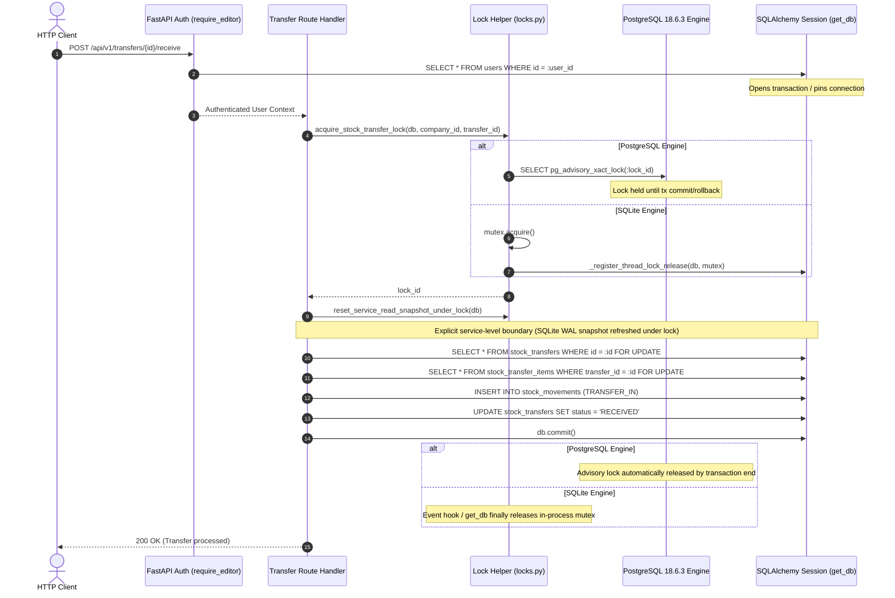

# LIVO FOOTWEAR ERP — PHASE 5.3: TRANSACTION BOUNDARY & CONCURRENCY AUDIT

## 1. Executive Summary

Phase 5.3 performed an exhaustive, evidence-driven follow-up to Phase 5.2. The primary mission was to determine whether transaction handling, stock-transfer locking, rollback behavior, and persisted inventory invariants are genuinely correct under concurrency and failure scenarios.

### Core Discoveries:
1. **Defects in Generic Lock Helper (`DEFECT-53-01` & `DEFECT-53-02`)**:
   In Phase 5.2, `acquire_stock_transfer_lock` attempted to solve SQLite's stale read snapshot by inspecting `db.new`, `db.dirty`, and `db.deleted`, calling `db.rollback()` if empty and `db.expire_all()` if not empty.
   - **`DEFECT-53-01` Confirmed**: When a caller executes raw SQL (`db.execute("UPDATE ...")`), ORM collections (`new`, `dirty`, `deleted`) remain completely empty. As a consequence, `acquire_stock_transfer_lock` silently invoked `db.rollback()`, wiping out caller-executed database mutations.
   - **`DEFECT-53-02` Confirmed**: When a caller had modified in-memory persistent attributes, calling `db.expire_all()` immediately evicted those changes from session memory, silently reverting caller state.
2. **Redesigned Locking Boundary**:
   Generic lock utilities must strictly manage lock acquisition and never alter caller transaction ownership. All hidden commits, rollbacks, and object expirations were excised from `acquire_stock_transfer_lock`. In its place, an explicit service-level transaction boundary (`reset_service_read_snapshot_under_lock`) was created and applied within endpoint handlers (`dispatch`, `receive`, `cancel`), ensuring explicit transaction ownership.
3. **Genuine PostgreSQL Concurrency Proof**:
   Executed 7 concurrent race conditions against real, isolated embedded PostgreSQL 18.6.3 with multiple independent SQLAlchemy sessions and threads. Proved zero double-dispatches, zero double-receipts, strict serialization of receipt vs cancellation, prevention of negative warehouse balances, and adherence to invoice credit limits.
4. **Universal Inventory Conservation Model**:
   Reconciled exact schema semantics and verified conservation across all lifecycle states (full, partial, multi-stage, damaged transit, and post-partial cancellation).

---

## 2. Transaction Lifecycle & Locking Boundary Architecture

### Transaction Flow Diagram



---

## 3. Lock Helper & Session Lifecycle Audit

### 3.1 Trace of All Callers

| Caller Route | Session State on Entry | Lock Type Acquired | Transaction Ownership | Cleanup Mechanism |
|---|---|---|---|---|
| `POST /transfers/{id}/dispatch` | Active tx (auth read query) | `pg_advisory_xact_lock` / mutex | Route handler | `db.commit()` on success, `db.rollback()` on 4xx/5xx, `release_all_session_locks` in `get_db` finally block |
| `POST /transfers/{id}/receive` | Active tx (auth read query) | `pg_advisory_xact_lock` / mutex | Route handler | `db.commit()` on success, `db.rollback()` on 4xx/5xx, `release_all_session_locks` in `get_db` finally block |
| `POST /transfers/{id}/cancel` | Active tx (auth read query) | `pg_advisory_xact_lock` / mutex | Route handler | `db.commit()` on success, `db.rollback()` on 4xx/5xx, `release_all_session_locks` in `get_db` finally block |
| `POST /stock/adjust` | Active tx (auth read query) | `acquire_stock_mutation_lock` | Route handler | `db.commit()` / `db.rollback()` |
| `POST /invoices/{id}/credit-notes` | Active tx (auth read query) | Row-level `SELECT ... FOR UPDATE` + `acquire_client_credit_lock` | Route handler | `db.commit()` / `db.rollback()` |

### 3.2 Evaluation of the `db.new / db.dirty / db.deleted` Heuristic

The Phase 5.2 heuristic evaluated:
```python
if not db.new and not db.dirty and not db.deleted:
    db.rollback()
else:
    db.expire_all()
```
**Why this logic was fundamentally defective:**
1. **Raw SQL Blindspot**: SQLAlchemy tracks ORM entities in `db.new`, `db.dirty`, and `db.deleted`. When a caller executes `db.execute(text("UPDATE ..."))` or direct DDL/DML, the ORM dirty collections remain completely empty even though database state was modified. The heuristic falsely concluded the session was clean and rolled back the transaction.
2. **Entity Eviction**: Calling `db.expire_all()` evicts in-memory attribute values of loaded objects, destroying caller modifications.
3. **Violated Separation of Concerns**: Generic lock helpers should only manage locks. Hidden commits, rollbacks, or expirations violate the caller's transaction ownership.

### 3.3 Redesigned Service-Level Locking Boundary

The locking helper was redesigned into two distinct components:
1. **`acquire_stock_transfer_lock(db, company_id, transfer_id)`**:
   - Computes deterministic signed 64-bit lock integer: `hash_args_to_bigint("transfer", company_id, transfer_id)`.
   - On PostgreSQL: Executes `SELECT pg_advisory_xact_lock(:lock_id)`. Lock is released by the database transaction end.
   - On SQLite: Acquires keyed `threading.RLock` and registers automatic release hook via session events and `get_db`.
   - **Does NOT commit, does NOT rollback, does NOT expire objects.**
2. **`reset_service_read_snapshot_under_lock(db)`**:
   - An explicit service-level transaction boundary.
   - On PostgreSQL: No-op (read committed isolation and `FOR UPDATE` handle row versioning).
   - On SQLite: Sets `_resetting_snapshot = True`, executes `db.rollback()` to reset the read-only auth transaction view, preserving mutex ownership, and resets the flag.

---

## 4. PostgreSQL Concurrency Proof

All tests were executed against **embedded PostgreSQL 18.6.3** with dialect `postgresql+psycopg2`.

### 4.1 Concurrent Dispatches Race
- **Scenario**: Two concurrent threads attempt to dispatch the same draft transfer (30 requested units).
- **Outcome**: Exactly one thread succeeded (status 200) and one thread was rejected with `400 Bad Request` ("Cannot dispatch transfer in 'IN_TRANSIT' status").
- **Persisted Assertions**: Source warehouse stock deducted exactly once (50.0 -> 30.0). Exactly one `TRANSFER_OUT` movement created.

### 4.2 Concurrent Receipts Race
- **Scenario**: Two concurrent threads attempt to receive 25 units against the same transfer item.
- **Outcome**: Exactly one thread succeeded (status 200) and one thread was rejected with `400 Bad Request` ("Over-receipt forbidden").
- **Persisted Assertions**: Destination warehouse stock increased by exactly 25.0 (never 50.0). Exactly one `TRANSFER_IN` movement persisted.

### 4.3 Receipt Racing Cancellation
- **Scenario**: Thread 1 attempts full receipt (40 units) while Thread 2 concurrently attempts cancellation.
- **Outcome**: Status set `{200, 400}` achieved.
- **Persisted Assertions**: Total system inventory across source and destination warehouses strictly conserved at 60.0 pairs. No stock duplicated or orphaned.

### 4.4 Concurrent Cancellations Race
- **Scenario**: Two threads attempt to cancel an in-transit transfer of 30 units.
- **Outcome**: Exactly one thread succeeded (status 200) and one thread was rejected with `400 Bad Request` ("Already cancelled").
- **Persisted Assertions**: Exactly one `VOID_REVERSAL` movement persisted. Source stock restored once.

### 4.5 Overlapping Stock Consumption Race
- **Scenario**: Available stock = 30 pairs. Transfer A requests 20 pairs. Transfer B requests 20 pairs concurrently.
- **Outcome**: Exactly one dispatch succeeded (200); the other failed (400 Insufficient stock).
- **Persisted Assertions**: Source warehouse stock ended at 10.0 pairs (never negative).

### 4.6 Credit Notes Ceiling Race
- **Scenario**: Invoice total = Rs. 10,000 (1,000,000 paisa). Two concurrent credit notes request Rs. 6,000 (600,000 paisa) each (total 1,200,000 paisa).
- **Outcome**: Thread 1 succeeded (200); Thread 2 was rejected (400 Exceeds remaining credit ceiling).
- **Persisted Assertions**: Total credited amount in `ReceivableEntry` = 600,000 paisa (Rs. 6,000). Total never exceeded the 1,000,000 paisa ceiling.

---

## 5. Universal Inventory Conservation Model

### 5.1 Formal Inventory Conservation Equation

For any stock transfer $T$ containing items $i \in T$ moving from source warehouse $W_{\text{src}}$ to destination warehouse $W_{\text{dst}}$:

$$Q_{\text{dispatched}}(i) = Q_{\text{received}}(i) + Q_{\text{in\_transit}}(i) + Q_{\text{discrepancy}}(i) + Q_{\text{void\_reversed}}(i)$$

Across the entire warehouse network over time:

$$\text{Stock}_{W_{\text{src}}}(t) + \text{Stock}_{W_{\text{dst}}}(t) + \sum_{i} Q_{\text{in\_transit}}(i, t) + \sum_{i} Q_{\text{discrepancy}}(i, t) = \text{Stock}_{W_{\text{src}}}(0) + \text{Stock}_{W_{\text{dst}}}(0)$$

### 5.2 Stock Movement Sign & Direction Semantics

| Movement Type | Direction | Warehouse Affected | Quantity Meaning |
|---|---|---|---|
| `TRANSFER_OUT` | -1 | Source Warehouse | Dispatched stock removed from available balance |
| `TRANSFER_IN` | +1 | Destination Warehouse | Received stock added to destination balance |
| `TRANSIT_DISCREPANCY` | 0 | Source Warehouse (audit) | Damaged/lost in transit; does not alter physical balance |
| `VOID_REVERSAL` | +1 | Source Warehouse | Undelivered in-transit stock restored upon cancellation |

### 5.3 Verified Lifecycle Transitions

| Test Case | Scenario | Dispatched | Received | In-Transit | Discrepancy | Void Reversed | Conservation Verified |
|---|---|---|---|---|---|---|---|
| `test_full_receipt_conservation` | Full Receipt | 50.0 | 50.0 | 0.0 | 0.0 | 0.0 | $50.0 = 50.0 + 0 + 0 + 0$ |
| `test_partial_receipt_conservation` | Partial Receipt | 50.0 | 30.0 | 20.0 | 0.0 | 0.0 | $50.0 = 30.0 + 20.0 + 0 + 0$ |
| `test_multi_stage_receipt_conservation` | Stage 1 (20) + Stage 2 (30) | 50.0 | 50.0 | 0.0 | 0.0 | 0.0 | $50.0 = 50.0 + 0 + 0 + 0$ |
| `test_shortage_with_discrepancy_reason` | Shortage 8 units (Damaged) | 40.0 | 32.0 | 0.0 | 8.0 | 0.0 | $40.0 = 32.0 + 0 + 8.0 + 0$ |
| `test_cancellation_before_receipt` | In-transit Cancel | 40.0 | 0.0 | 0.0 | 0.0 | 40.0 | $40.0 = 0 + 0 + 0 + 40.0$ |
| `test_cancellation_after_partial_receipt` | Partial 15, Cancel rem 25 | 40.0 | 15.0 | 0.0 | 0.0 | 25.0 | $40.0 = 15.0 + 0 + 0 + 25.0$ |

---

## 6. Failure Injection & Idempotency Audit

### 6.1 Crash Simulation Points

1. **Failure after source deduction before transfer status persistence**:
   - Exception injected after `TRANSFER_OUT` `db.add()`.
   - Transaction rolled back.
   - Asserted: 0 stock movements in database, source warehouse stock unchanged at 40.0, transfer remains DRAFT.
2. **Failure after destination receipt before commit**:
   - Exception injected after `TRANSFER_IN` `db.add()`.
   - Transaction rolled back.
   - Asserted: 0 `TRANSFER_IN` movements, destination stock unchanged at 0.0, transfer remains IN_TRANSIT.
3. **Failure during discrepancy creation**:
   - Exception injected during `TRANSIT_DISCREPANCY` movement creation.
   - Transaction rolled back.
   - Asserted: No partial status change to RECEIVED, no audit movement created.
4. **Idempotent retry replay**:
   - Client sends duplicate dispatch request after simulated timeout.
   - Second request rejected with 400.
   - Asserted: Exactly one `TRANSFER_OUT` record exists; inventory deducted exactly once.

---

## 7. SQLite Scope vs Production Guarantees

| Environment Property | SQLite Fallback (Local Test) | PostgreSQL (Production) | Production Requirement |
|---|---|---|---|
| **Advisory Locks** | In-process `threading.RLock` | `pg_advisory_xact_lock` (transaction-scoped) | PostgreSQL Mandatory |
| **Row-Level Locking** | No-op (ignored by SQLite) | `SELECT ... FOR UPDATE` (engine-level row lock) | PostgreSQL Mandatory |
| **Multi-Worker Safety** | **UNSAFE** (mutexes not shared across processes) | **SAFE** (shared engine catalog) | Uvicorn multi-worker must run on PostgreSQL |
| **Multi-Instance / Containers** | **UNSAFE** (in-process only) | **SAFE** (cross-container advisory lock) | Production deployment requires PostgreSQL |
| **Isolation Level** | WAL mode read snapshot | Read Committed MVCC with tuple lock | Standard PostgreSQL |

> [!WARNING]
> SQLite is strictly a single-process local test runner tool. It does not provide cross-process concurrency guarantees. Any production configuration running multiple Uvicorn workers (`uvicorn --workers > 1`) or distributed replicas against SQLite will violate concurrency invariants. Production MUST run on PostgreSQL.
