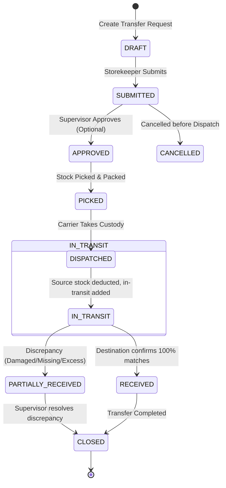

# LOCATION HIERARCHY, PRODUCT TRACEABILITY & INTER-BRANCH TRANSFER ARCHITECTURE

**Project:** LIVO Footwear ERP  
**Document:** Architecture Design & Data Contract  
**Status:** Approved for Implementation (Phase 3–5)  
**Author:** Coordinated Architecture & Logistics Engineering Team  

---

## 1. Architectural Mission

Upgrade the existing single-tier `warehouses` structure into a production-grade, multi-tier location hierarchy that guarantees:
1. **Physical Footwear Plant Fidelity:** Accurately represents raw material stores, WIP lines, finished goods racks/bins, central dispatch, and remote branch showrooms.
2. **Authoritative Single-Ledger Balance:** Retains the immutable append-only `StockMovement` pattern, preventing divergent ledgers.
3. **Multi-Location Transfers with Independent Receipt Confirmation:** Eliminates the "lost in transit" blindspot by introducing a strict state machine where dispatch moves stock into an `IN_TRANSIT` state and destination branch managers must explicitly verify and accept received quantities.
4. **Batch-Level Provenance & Optional Serial Tracking:** Preserves the production batch, article code, size, and color identity across every movement, with optional serial tracking for high-value footwear pairs.

---

## 2. Location Hierarchy Design

### 2.1 Configurable Node Tree
The hierarchy extends the existing `warehouses` table through a self-referential parent-child relationship with a typed classification:

```text
Organization (Company Tenant Root)
  └── Facility / Plant (e.g., "Biratnagar Main Footwear Factory")
        ├── Raw Material Store (Leather, Soles, Chemical Adhesives, Boxes)
        ├── Production Workstation / WIP Floor (Cutting, Stitching, Assembly, Lasting)
        ├── Finished Goods Central Store
        │     └── Storage Zone (e.g., "Zone A - Men's Leather Boots")
        │           └── Rack / Shelf (e.g., "Rack 04")
        │                 └── Bin / Location (e.g., "Bin 12-B")
        ├── Quality Quarantine / Damaged Holding Area
        └── Factory Dispatch & Loading Bay
  └── Branch Showroom / Outlet (e.g., "Kathmandu Wholesale Depot", "Pokhara Branch")
        ├── Branch Front Store
        └── Branch Backroom Reserve
  └── Virtual Operational Node: IN_TRANSIT (Tenant-scoped transit holding per transfer)
```

### 2.2 Location Entity Schema (`locations`)
To ensure complete backward compatibility with existing code referencing `warehouses`, the existing `warehouses` table is extended (or aliased) with standard hierarchy attributes:

```sql
-- Extended Location Model / Table: locations (mapped to warehouses)
ALTER TABLE warehouses ADD COLUMN parent_id INTEGER REFERENCES warehouses(id) ON DELETE SET_NULL;
ALTER TABLE warehouses ADD COLUMN location_type VARCHAR(32) NOT NULL DEFAULT 'WAREHOUSE';
ALTER TABLE warehouses ADD COLUMN facility_code VARCHAR(32) NULL;
ALTER TABLE warehouses ADD COLUMN address_line VARCHAR(255) NULL;
ALTER TABLE warehouses ADD COLUMN city VARCHAR(64) NULL;
ALTER TABLE warehouses ADD COLUMN is_branch BOOLEAN NOT NULL DEFAULT FALSE;
ALTER TABLE warehouses ADD COLUMN allow_dispatch BOOLEAN NOT NULL DEFAULT TRUE;
ALTER TABLE warehouses ADD COLUMN allow_receipt BOOLEAN NOT NULL DEFAULT TRUE;

CREATE INDEX ix_warehouses_parent ON warehouses(company_id, parent_id);
CREATE INDEX ix_warehouses_type ON warehouses(company_id, location_type);
```

#### Valid Location Types (`location_type`)
- `FACILITY`: Top-level factory plant or physical compound.
- `RAW_MATERIAL_STORE`: Storage for procurement receipts and BOM issues.
- `PRODUCTION_FLOOR`: WIP assembly area.
- `FINISHED_STORE`: Central finished footwear store.
- `STORAGE_ZONE`: Subsection within a finished store.
- `RACK_BIN`: Exact shelf and bin location.
- `DISPATCH_BAY`: Staging area for outgoing customer/branch shipments.
- `BRANCH_STORE`: Remote wholesale showroom or retail depot.
- `QUARANTINE`: Defective or damaged stock holding area.
- `IN_TRANSIT`: Virtual location tracking goods between dispatch and destination acceptance.

---

## 3. Agreed Product Tracking Policy

### 3.1 Logical Inventory Identity
Inventory is tracked at the **Product + Size + Color + Batch** level by default, with an optional **Serial Number** for unit-tracked articles:

$$\text{Inventory Identity} = \langle \text{company\_id}, \text{location\_id}, \text{product\_id}, \text{size}, \text{color}, \text{batch\_id}, [\text{serial\_number}] \rangle$$

1. **Product / Article Master (`products`):**
   - Canonical footwear model (e.g., `ART-801`, "Classic Chelsea Boot").
2. **Variant Dimensions:**
   - `size`: Numeric or alpha size (e.g., `39`, `40`, `41`, `42`).
   - `color`: Predefined catalog color or custom floor color (e.g., `Black`, `Cognac Brown`).
3. **Batch / Lot ID (`production_batches`):**
   - Captures the exact production assembly date, shift, workers, and raw materials consumed via BOM.
4. **Optional Serial / Unit ID (`product_serials`):**
   - For premium articles, each physical pair carries a unique scannable serial code (e.g., `SN-801-41-2026-0001`).

### 3.2 Product Serial Master (`product_serials`)
```sql
CREATE TABLE product_serials (
    id SERIAL PRIMARY KEY,
    company_id INTEGER NOT NULL REFERENCES companies(id),
    product_id INTEGER NOT NULL REFERENCES products(id),
    batch_id INTEGER NULL REFERENCES production_batches(id),
    serial_number VARCHAR(64) NOT NULL,
    current_location_id INTEGER NOT NULL REFERENCES warehouses(id),
    status VARCHAR(32) NOT NULL DEFAULT 'AVAILABLE', -- AVAILABLE, IN_TRANSIT, SOLD, DAMAGED, RETURNED
    created_at TIMESTAMP WITH TIME ZONE DEFAULT CURRENT_TIMESTAMP,
    CONSTRAINT uq_company_product_serial UNIQUE (company_id, serial_number)
);

CREATE INDEX ix_product_serials_lookup ON product_serials(company_id, product_id, current_location_id);
```

---

## 4. Multi-Location Transfer State Machine

### 4.1 Transfer Lifecycle



### 4.2 State Machine Rules & Invariants
1. **Independent Destination Receipt:** A dispatched transfer does **NOT** increment destination stock. It sits in `IN_TRANSIT` until destination warehouse staff counts the physical pairs and posts a receipt voucher.
2. **Atomic Dispatch Transaction:**
   - Under PostgreSQL advisory lock `acquire_stock_mutation_lock`, the system verifies physical availability at the source location.
   - Appends `StockMovement(direction=-1, warehouse_id=source_id, movement_type='TRANSFER_OUT', ref_type='transfer', ref_id=t.id)`.
   - Appends `StockMovement(direction=+1, warehouse_id=in_transit_id, movement_type='TRANSFER_TRANSIT_IN', ref_type='transfer', ref_id=t.id)`.
   - Updates transfer status to `IN_TRANSIT`.
3. **Destination Receipt Transaction:**
   - Destination staff inspects goods and submits actual received quantities.
   - Appends `StockMovement(direction=-1, warehouse_id=in_transit_id, movement_type='TRANSFER_TRANSIT_OUT', ref_type='transfer', ref_id=t.id)`.
   - Appends `StockMovement(direction=+1, warehouse_id=dest_id, movement_type='TRANSFER_IN', ref_type='transfer', ref_id=t.id)`.
   - If `received_quantity < dispatched_quantity`:
     - Creates `TransferDiscrepancy` record recording missing/damaged pairs.
     - Leaves discrepant quantity quarantined or writes `StockMovement` to `QUARANTINE_HOLDING`.
     - Status becomes `PARTIALLY_RECEIVED`.

### 4.3 Transfer Tables Schema

```sql
CREATE TABLE stock_transfers (
    id SERIAL PRIMARY KEY,
    company_id INTEGER NOT NULL REFERENCES companies(id),
    transfer_number VARCHAR(64) NOT NULL,
    source_location_id INTEGER NOT NULL REFERENCES warehouses(id),
    destination_location_id INTEGER NOT NULL REFERENCES warehouses(id),
    status VARCHAR(32) NOT NULL DEFAULT 'DRAFT', -- DRAFT, SUBMITTED, APPROVED, PICKED, DISPATCHED, IN_TRANSIT, PARTIALLY_RECEIVED, RECEIVED, CLOSED, CANCELLED
    carrier_name VARCHAR(128) NULL,
    vehicle_number VARCHAR(64) NULL,
    dispatch_date_ad DATE NULL,
    dispatch_date_bs VARCHAR(10) NULL,
    received_date_ad DATE NULL,
    received_date_bs VARCHAR(10) NULL,
    dispatched_by_id INTEGER NULL REFERENCES users(id),
    received_by_id INTEGER NULL REFERENCES users(id),
    notes TEXT NULL,
    created_at TIMESTAMP WITH TIME ZONE DEFAULT CURRENT_TIMESTAMP,
    CONSTRAINT uq_company_transfer_number UNIQUE (company_id, transfer_number)
);

CREATE TABLE stock_transfer_items (
    id SERIAL PRIMARY KEY,
    transfer_id INTEGER NOT NULL REFERENCES stock_transfers(id) ON DELETE CASCADE,
    product_id INTEGER NOT NULL REFERENCES products(id),
    size VARCHAR(20) NOT NULL,
    color VARCHAR(50) NULL,
    batch_id INTEGER NULL REFERENCES production_batches(id),
    requested_quantity NUMERIC(12, 2) NOT NULL,
    dispatched_quantity NUMERIC(12, 2) NOT NULL DEFAULT 0.0,
    received_quantity NUMERIC(12, 2) NOT NULL DEFAULT 0.0,
    discrepancy_quantity NUMERIC(12, 2) NOT NULL DEFAULT 0.0,
    discrepancy_reason VARCHAR(64) NULL, -- DAMAGED_IN_TRANSIT, MISSING_SHORTAGE, REJECTED
    discrepancy_notes VARCHAR(255) NULL
);
```

---

## 5. End-to-End Product & Batch Traceability Design

### 5.1 Traceability Query Strategy
The system reconstructs an unbroken chain of custody for any footwear batch:

```text
Raw Material Procurement (Supplier -> GRN Voucher -> Unit Cost Paisa)
    └── BOM Material Usage (Raw Material -> Batch BOM Issue -> Quantity Deducted)
          └── Production Assembly (Batch Number, Shift, Date BS, Color, Output Pairs)
                └── Central Finished Store Receipt (Racks & Bins)
                      └── Inter-Location Transfer (Factory Store -> In-Transit -> Branch Receipt)
                            └── Wholesale Sales Dispatch (Sales Order -> Sequential VAT Invoice -> Client)
```

### 5.2 Unified Traceability API (`GET /api/v1/traceability`)
- Query parameters: `batch_number`, `product_id`, `serial_number`, `location_id`, `date_from_bs`, `date_to_bs`.
- Output:
  - Header: Article Code, Name, Size, Color, Batch Number, Production Date (AD/BS).
  - Current Holdings: Array of `{ location_name, location_type, available_quantity, in_transit_quantity }`.
  - Chronological Timeline: Immutable sequence of events with actor, source doc, timestamps, and quantities.

---

## 6. Backward Compatibility & Data Safety

1. **Existing `Warehouse` Table Preserved:**
   - Existing code queries `Warehouse.id` and `Warehouse.company_id`. Adding nullable hierarchy columns (`parent_id`, `location_type`, `is_branch`) guarantees that all existing tests and queries continue to function without modification.
2. **Default Main Warehouse Kept Intact:**
   - Company default warehouse (`WH-MAIN-{company_id}`) remains the root factory store for legacy data.
3. **Zero Fabricated Provenance:**
   - Historical stock movements without `batch_id` are clearly labeled as `LEGACY_PRE_MIGRATION` in the traceability view rather than guessing batches.
