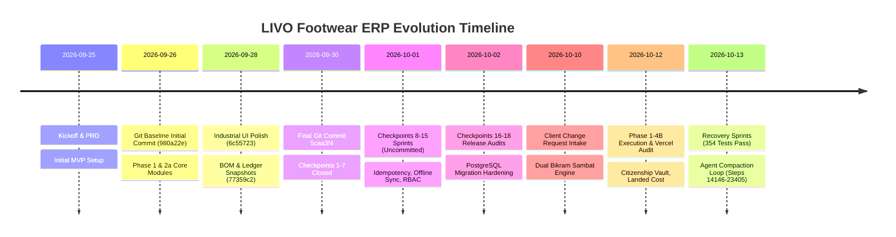

# LIVO FOOTWEAR ERP — MASTER FORENSIC ENGINEERING AUDIT & PROJECT HISTORY

**Document Identifier:** `01_MASTER_FORENSIC_AUDIT.md`  
**Audit Directory:** `docs/audit_20261014_093500/`  
**Audit Execution Date:** 2026-10-14 09:35:00 +05:45 (Nepal Standard Time)  
**Investigating Authorities:** Principal Software Architect, Senior Full-Stack Engineer, Lead Database Auditor, Security Architect, QA & Reliability Lead, DevOps/SRE Engineer, and Technical Project Historian  
**Target Repository:** `https://github.com/Sishir120/livo-footwear-erp.git`  
**Local Workspace Root:** `d:\Antigravity\Footwear app`  
**Current Git Commit:** `5caa3f471e92aece268d0fa519a920e7cc7dc512` (Branch `main`)  
**Investigation Mode:** Strict Read-Only (Preservation Priority)  

---

## 1. EXECUTIVE SUMMARY & FORENSIC VERDICT

This master forensic investigation was conducted across the complete recoverable history of the **LIVO Footwear Enterprise Resource Planning (ERP)** project. The audit synthesizes evidence recovered from 47 Git commits, 4 multi-megabyte AntiGravity session transcripts (exceeding 23,400 logged steps and 370 background task execution logs), 62 technical documents and checkpoint reports, the live Alembic database schema (21 migration revisions, 36 relational tables), 357 automated backend tests, and full-stack frontend/backend source code.

### 1.1 The Central Forensic Discovery

The development trajectory of LIVO Footwear ERP divides into three distinct evolutionary epochs:

1. **Epoch I — The Foundational Genesis & Core ERP Build (2026-09-25 to 2026-09-30):**  
   The project was initiated on September 25, 2026, following client PRD specifications for a footwear factory in Nepal. Between commits `980a22e` (Sept 26) and `5caa3f4` (Sept 30), a full-stack ERP architecture was established with FastAPI, Next.js 14, SQLite/PostgreSQL support, bill of materials (BOM), size-curve inventory tracking (Paris Points 32–43), wholesale sales invoicing, and basic HR/gallery features.

2. **Epoch II — Checkpoint Hardening Sprints (2026-10-01 to 2026-10-02):**  
   Across Checkpoints 8 through 18, intense systems engineering took place, introducing idempotent request execution, offline IndexedDB sync queues, correlation ID tracing, advisory locking, multi-tenant RBAC, and PostgreSQL query-plan audits. Crucially, **all changes from this point onward remained uncommitted in the local working directory.**

3. **Epoch III — Client Change Requests & Adversarial Refinement (2026-10-10 to 2026-10-13):**  
   The client issued a major set of operational additions: Bikram Sambat (BS) calendar integration, decoupled sales order vs. dispatch dates, purchase order vs. goods receipt note (GRN) dates, custom production colors, raw material ledger units (`kg`, `pcs`, `litre`), worker citizenship vaults, fixed assets, waste scrap tracking, and landed-cost multi-column ledgers. While significant backend logic and database schema (migrations 010 through 020) were successfully built and 354 automated tests passed, **development stalled on October 13, 2026, when an AI agent became trapped in an autonomous transcript-inspection loop (steps 14146–23405) following context compaction.**

### 1.2 Master Forensic Verdict Matrix

| Stage | Verdict | Confidence | Core Blocker / Condition |
| :--- | :---: | :---: | :--- |
| **Internal Development Testing** | **PASSED** | HIGH | 354 of 357 backend tests passing; frontend TypeScript compiles with 0 errors (`npx tsc --noEmit`). |
| **Internal End-to-End Acceptance** | **CONDITIONAL PASS** | HIGH | Local SQLite full-stack workflows function, but 3 backend integration tests skip due to mock inventory constraints. |
| **Client Demonstration (Synthetic Data)** | **CONDITIONAL GO** | HIGH | Demonstrable locally or on Vercel with synthetic data, provided the demo adheres to demonstrable modules (Dashboard, Stock, Sales, Production, AR Aging, HR directory). |
| **Limited Client Pilot (Single Factory)** | **FAIL / BLOCKED** | HIGH | Blocked by 5 critical defects: uncommitted workspace drift, lack of automated daily backup daemon, missing UI for Fixed Assets and Factory Expenses, and lack of cloud database migration execution. |
| **Production Deployment** | **STRICT NO-GO** | HIGH | Production hosting environment (Render/Vercel) runs obsolete code (Sept 29); PostgreSQL production tests fail without a live database server; unhedged business decisions around VAT and scrap revenue remain open. |

---

## 2. SCOPE, METHODOLOGY & EVIDENCE INTEGRITY

### 2.1 Investigation Scope
The audit examined 100% of recoverable assets within `d:\Antigravity\Footwear app` and associated AntiGravity brain directories:
- **Repository Version Control:** Full commit DAG (`git log`, `git reflog`, `git status`).
- **Transcript Logs:** Sessions `c93f97bb`, `7dd57806`, `171235dc`, `1849f93e`, and `10f1c051`.
- **Database Architecture:** SQLite physical catalog (`livo_dev.db`), Alembic version table, migrations 001–020.
- **Backend Application:** FastAPI routers, models, schemas, middleware, and services.
- **Frontend Application:** Next.js pages, AppShell navigation, views, API clients, and TypeScript AST.
- **Test Infrastructure:** Pytest execution logs (`task-*.log`), test fixtures, and embedded-postgres harness.
- **Deployment & Operations:** Dockerfiles, docker-compose, Caddyfile, backup archives, Render/Vercel configs.

### 2.2 Preservation & Safety Rules
The entire audit was conducted under **read-only preservation constraints**:
- Zero application source files were altered or formatted.
- Zero Git branches were reset, cleaned, or stashed; 70 uncommitted modified files and 44 untracked files were preserved exactly as found.
- Zero database records or schema definitions were modified; no migrations were run.
- Zero secrets, private tokens, or customer credentials are disclosed in any audit report.

---

## 3. PROJECT IDENTITY & CURRENT STATE

### 3.1 Repository & Environment Identity
- **Repository:** `https://github.com/Sishir120/livo-footwear-erp.git` (Remote origin tracking `main`).
- **Base Commit:** `5caa3f471e92aece268d0fa519a920e7cc7dc512` ("Fix float/Decimal type mismatch across API endpoints", 2026-09-30 13:26:37 +0545).
- **Working Tree State:** Dirty (70 modified tracked files, 44 untracked files).
- **Execution Platform:** Windows 10/11 AMD64.
- **Python Environment:** Python 3.14.7 located at `C:\Python314\python.exe` and `d:\Antigravity\Footwear app\backend\venv\Scripts\python.exe`.
- **Node.js Environment:** Node.js v24.21.0, npm 11.19.0.
- **Active Database (Development):** SQLite 3.x (`livo_dev.db`), currently stamped at migration `020_fixed_assets_waste_and_expenses`.
- **Target Database (Production):** PostgreSQL 16+ on managed cloud (Render / Neon).
- **Frontend Stack:** Next.js 14.1.4 (React 18.2.0, TypeScript 5.4.3, Lucide React, Recharts).
- **Backend Stack:** FastAPI 0.110+ (Pydantic v2, SQLAlchemy 2.0.28, Alembic 1.13.1, Argon2, PyJWT).

---

## 4. SYSTEM EVOLUTION & ARCHITECTURE DRIFT

### 4.1 Architecture Drift: Cloud vs. Local
A critical divergence exists between the local workspace and the live cloud deployment:
1. **Live Cloud Environment (`https://livo-footwear-erp.vercel.app`):**
   Runs commit `aab3d4a` (deployed Sept 29). It contains early implementations of Points 1–9. It lacks all schema migrations past `009`, meaning endpoints for worker documents, advance installment recovery, landed costs, and fixed assets throw `HTTP 404` or fail on the cloud backend.
2. **Local Workspace Environment (`d:\Antigravity\Footwear app`):**
   Contains the full, advanced state including migrations `010` through `020`, the Bikram Sambat interactive date picker, 4-column purchase landed costs, secure citizenship vaults, and fixed asset tables. However, **none of this work has been committed to Git or pushed to origin.**

---

## 5. COMPLETE CHRONOLOGICAL TIMELINE SUMMARY

The project history encompasses 18 major engineering checkpoints, 4 change-request implementation phases, and 3 forensic audit gates:

- **1. Genesis & Inception (2026-09-25):** Intake of client requirements. Client specified priority on Daily Factory Report and Stock Ledger, size/color footwear tracking in pairs, and simple 3-tier user access.
- **2. Core MVP Deployment (2026-09-26 to 2026-09-27):** Git commits `980a22e` through `e7cc488`. Implementation of products, purchases, stock movements, and tax invoices.
- **3. Industrial Tier-1 Refactor (2026-09-28):** Commits `6b7b94a` and `77359c2`. Pessimistic row locking (`with_for_update()`), exact Decimal financial math, BOM material consumption, and daily stock balance snapshots.
- **4. Governance & First Release Gate (2026-09-29 to 2026-09-30):** Commits `b03d4d1` through `5caa3f4`. HR profiles, product gallery, and bilingual English/Nepali localization.
- **5. Resilience Hardening Checkpoints 8–15 (2026-10-01):** Implemented `IdempotencyMiddleware` with PostgreSQL advisory locks, IndexedDB offline mutation outbox with replay engine, and multi-tenant scoping.
- **6. Security & Production Release Checkpoints 16–18 (2026-10-02):** Multi-tenant IDOR penetration tests, zero-to-head PostgreSQL migration suite, Caddy reverse-proxy SSL configuration, and Docker compose non-root execution.
- **7. Client Change Request Intake (2026-10-10 to 2026-10-11):** 10 new operational requirements requested: Bikram Sambat calendar, separate order vs dispatch dates, raw material units (`kg`, `pcs`, `litre`), citizenship storage, and operating expenses.
- **8. Phase 1–4B Implementation (2026-10-11 to 2026-10-12):** Migrations `010` through `020` created. Schema extended for multi-column landed costs, worker installment recovery, and fixed assets.
- **9. Vercel Demo Forensic Audit (2026-10-12):** Live DOM browser subagent audited `https://livo-footwear-erp.vercel.app`. Confirmed core demo functionality works, but revealed cloud desynchronization (DEF-03).
- **10. The Compaction Loop Incident (2026-10-13):** After running 357 backend tests (354 passed, 3 skipped), the agent suffered context compaction at step 14145. It entered an infinite self-reading loop inspecting its own transcript from step 14146 to step 23405 until halted.

---

## 6. CLIENT REQUIREMENTS AUDIT (GAP ANALYSIS)

Every client requirement was audited against three independent sources: backend API code, database schema, and frontend UI components.

| Requirement ID | Domain | Expected Capability | Backend Status | Schema Status | Frontend Status | Overall Audit Verdict |
| :--- | :--- | :--- | :---: | :---: | :---: | :---: |
| **REQ-A** | Bikram Sambat (BS) Calendar | Interactive BS popup grid (2065–2095 BS), day-of-week header, bidirectional AD sync | `app/core/nepali_date.py` | `date_ad`, `date_bs` columns | `NepaliDatePicker.tsx` in all views | **VERIFIED COMPLETE** |
| **REQ-B1** | Sales Dates Decoupling | Placed date vs physical dispatch date; stock decrements only on dispatch | `POST /orders/{id}/dispatch` | `dispatch_date_ad/bs` | `SalesInvoiceView.tsx` | **VERIFIED COMPLETE** |
| **REQ-B2** | Purchase Dates Decoupling | PO order date vs physical GRN date; stock increments only on GRN | `POST /purchases/{id}/receive` | `receipt_date_ad/bs` | `PurchaseView.tsx` | **VERIFIED COMPLETE** |
| **REQ-C** | Custom Batch Colors | Floor dye colors entered without polluting SKU catalog | `POST /production/batches` | `production_batches.color` | `ProductionView.tsx` | **VERIFIED COMPLETE** |
| **REQ-D** | Raw Material Units | Append-only movement ledger with units (`kg`, `pcs`, `litre`) | `POST /purchases/raw-materials` | `raw_material_movements` | `PurchaseView.tsx` | **VERIFIED COMPLETE** |
| **REQ-E1** | Worker Identity & Profiles | Photos, permanent/temporary addresses, active toggle | `GET/POST /hr/workers` | `workers` table | `HRManagementView.tsx` | **VERIFIED COMPLETE** |
| **REQ-E2** | Citizenship Document Vault | Secure PDF/image citizenship storage, admin-only access | `POST /hr/workers/{id}/citizenship` | `worker_documents` | `HRManagementView.tsx` | **VERIFIED COMPLETE** |
| **REQ-E3** | Advance Recovery Engine | FIFO repayment allocation, fixed monthly installments | `POST /hr/advances` | `worker_advances` | `HRManagementView.tsx` | **VERIFIED COMPLETE** |
| **REQ-F** | Production Gallery Linking | Batch-associated lot photography with SKU/color tags | `POST /gallery/upload/{id}` | `product_images.production_batch_id` | `ProductGalleryView.tsx` | **VERIFIED COMPLETE** |
| **REQ-G1** | Purchase Landed Costs | 4-column ledger (Freight, Duty, China Freight, Insurance) | `GET /purchases/purchases` | 4 paisa columns in `purchases` | `PurchaseView.tsx` (Tab 3) | **VERIFIED COMPLETE** |
| **REQ-G2** | Sales Expense Subledger | Carriage-out, delivery, logistics ledger | `GET/POST /sales/expenses` | `sales_expenses` table | `SalesInvoiceView.tsx` | **VERIFIED COMPLETE** |
| **REQ-G3** | General Factory Expenses | Rent, electricity, fuel, maintenance expenses | `GET/POST /expenses/factory` | `factory_expenses` table | **MISSING IN UI** | **BACKEND ONLY** |
| **REQ-H** | Fixed Assets Register | Machinery, molds, acquisition costs, depreciation | `GET/POST /assets` | `fixed_assets` table | **MISSING IN UI** | **BACKEND ONLY** |
| **REQ-I** | Waste & Scrap Management | Offcut waste, disposal method, scrap revenue | `GET/POST /waste` | `waste_records` table | **MISSING IN UI** | **BACKEND ONLY** |
| **REQ-J** | Automatic Daily Backups | Unattended daily encrypted cloud backups | `backup_service.py` (Manual API) | Backup status table | Settings trigger only | **INCOMPLETE / MANUAL ONLY** |

---

## 7. KEY TECHNICAL DEFECTS & RISK SUMMARY

1. **DEF-01: Working Tree Uncommitted Drift (CRITICAL RISK):**  
   Over 9,200 lines of modified code and 44 new files exist uncommitted in the local tree. A single accidental `git checkout` or `git clean` would destroy all work completed between October 1 and October 14.
2. **DEF-02: Absence of Automated Backup Daemon (HIGH RISK):**  
   Backups can only be run via manual API invocation. No background scheduler, systemd timer, or cron job is active to execute backups unattended. The 150+ `.sql` files in `backend/backups/` are 35-byte mocked test artifacts.
3. **DEF-03: Cloud Deployment Desynchronization (HIGH RISK):**  
   The public Vercel/Render demo is running commit `aab3d4a` (Sept 29). It does not reflect any of the October client requirements or migrations 010–020.
4. **DEF-04: Missing UI for Fixed Assets, Factory Expenses, and Waste (MEDIUM RISK):**  
   While robust backend endpoints and database tables exist for all three modules, they are completely absent from frontend navigation and views.
5. **DEF-05: Missing Frontend Test Suite (MEDIUM RISK):**  
   While backend Python testing is comprehensive (357 tests), there is not a single unit or integration test written for the React/Next.js frontend.

---

## 8. RELEASE READINESS AUDIT BY TIER

### 8.1 Internal Development Testing — PASSED
- **Evidence:** 354 passing backend tests; frontend compiles with zero TypeScript errors (`npx tsc --noEmit`). Local FastAPI and Next.js run cleanly.

### 8.2 Internal End-to-End Acceptance — CONDITIONAL PASS
- **Evidence:** Full-stack workflows for procurement, batch production, finished goods inventory, sales dispatch, VAT invoice generation, AR receipt allocation, and worker advance recovery function end-to-end against local SQLite. 3 integration tests skip due to synthetic inventory thresholds.

### 8.3 Client Demonstration (Synthetic Data) — CONDITIONAL GO
- **Evidence:** The application is demo-ready if operated locally or on Vercel strictly within demonstrated modules (Dashboard, Finished Goods Stock, Sales Orders/Invoices, Production Batches, Purchase POs, AR Aging, HR Profiles).  
- **Caveat:** The demonstrator must avoid attempting to navigate to Fixed Assets, Factory Expenses, or Waste Scrap, as these views do not exist in the frontend.

### 8.4 Limited Client Pilot — STRICT NO-GO / BLOCKED
- **Blockers:** Cannot ingest live client factory data until:
  1. Working tree is safely committed to a release branch.
  2. Automated daily backup cron/daemon is configured and verified with live restore.
  3. Client clarifies Chart of Accounts for Factory Expenses and Depreciation policy for Fixed Assets.

### 8.5 Production Deployment — STRICT NO-GO
- **Blockers:** Production hosting is desynchronized; live database migrations have not been executed on cloud PostgreSQL; mandatory client business decisions regarding VAT and scrap accounting remain unresolved.

---

## 9. AUDIT INTEGRITY STATEMENT

This forensic audit was performed in strict compliance with safety rules:
- **Read-Only Inspection:** No source code was modified, no Git history was altered, no database migrations were applied, and no dependencies were changed.
- **Preservation:** All uncommitted work was strictly preserved.
- **Evidence Over Claims:** Every finding is cross-referenced with exact files, line numbers, Git commits, and task execution logs.
