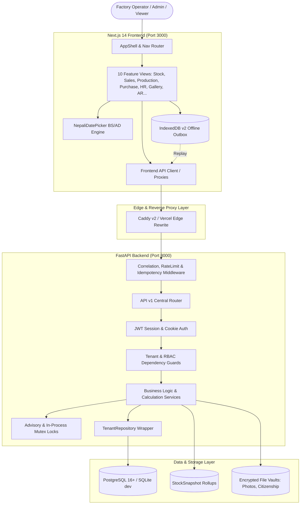
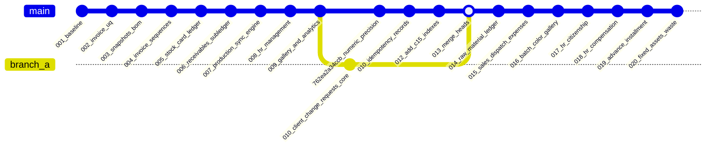

# LIVO FOOTWEAR ERP — ARCHITECTURE, DATABASE & API AUDIT

**Document Identifier:** `04_ARCHITECTURE_DATABASE_API_AUDIT.md`  
**Audit Directory:** `docs/audit_20261014_093500/`  
**Audit Execution Date:** 2026-10-14 09:35:00 +05:45 (Nepal Standard Time)  
**Scope:** Full-Stack Architecture, Database Catalog, Alembic Migrations, API Endpoints, Transaction Integrity, Concurrency Locking, and End-to-End Traceability.

---

## 1. FULL-STACK ARCHITECTURAL TOPOLOGY

The LIVO Footwear ERP is structured as a decoupled client-server web application designed for industrial factory floor operations:



---

## 2. FRONTEND ARCHITECTURE AUDIT

### 2.1 Route & View Inventory

The frontend is an application built with Next.js 14 (App Router). Primary views are mounted dynamically inside `frontend/src/components/AppShell.tsx`:

| View Identifier | Component File | Navigation Label | Primary Business Capabilities |
| :--- | :--- | :--- | :--- |
| `daily` | `AppShell.tsx` (Internal) | Dashboard (ड्यासबोर्ड) | Real-time floor velocity, realized cash ratios, production batch summary cards. |
| `stock` | `StockReportView.tsx` | Stock Ledger (स्टक लेजर) | Finished footwear matrix by Paris Points (32–43), raw material balances, adjustment logs. |
| `sales` | `SalesInvoiceView.tsx` | Sales & Invoicing (बिक्री तथा इनभ्वाइस) | Wholesale orders, statutory 13% VAT invoices, dispatch actions, sales expense ledger. |
| `receivables` | `PartyAgingView.tsx` | AR Aging (बाँकी हिसाब) | Accounts receivable credit subledger, 4 aging buckets, party statements, cash/bank receipt allocation. |
| `production` | `ProductionView.tsx` | Production Batches (उत्पादन ब्याच) | Batch entry dock, floor lot custom color typing, BOM raw material deduction, size curve distribution. |
| `purchase` | `PurchaseView.tsx` | Purchase (कच्चा पदार्थ खरिद) | Raw material POs, Goods Receipt Notes (GRN), 4-column landed cost ledger, vendor catalog. |
| `hr` | `HRManagementView.tsx` | HR Management (कर्मचारी व्यवस्थापन) | Worker directory, photo upload, citizenship vault (Admin only), advance installment recovery, payroll snapshots. |
| `gallery` | `ProductGalleryView.tsx` | Product Gallery (उत्पादन ग्यालरी) | Finished footwear media cards, batch photo links, secure downloads. |
| `analytics` | Mounted in Gallery/Sales | Analytics Ranks (श्रेणीकरण) | Top customer rankings, most-selling footwear models, production yield ratios. |
| `settings` | `SettingsView` (Modal) | Settings & Backups (सेटिङ्स) | Company profile, manual backup execution, database connection health telemetry. |

### 2.2 Missing Frontend Modules & UI Gaps
A critical architectural discrepancy exists:
1. **Fixed Assets Register:** Model and API exist (`/api/v1/assets`), but **no navigation button or UI component exists** in the frontend.
2. **General Factory Expenses:** Backend endpoint exists (`/api/v1/expenses/factory`), but **no UI view exists**.
3. **Waste & Scrap Management:** Backend router exists (`/api/v1/waste`), but **no UI view exists**.

### 2.3 Frontend State Management & API Layer
- **State Management:** React local state (`useState`, `useReducer`) combined with React Context (`LocaleContext` for bilingual localization).
- **Offline Resilience:** `frontend/src/lib/offlineQueue.ts` implements an append-only IndexedDB v2 outbox queue with exponential backoff and auth-pause safety.
- **Date Picking:** `frontend/src/components/NepaliDatePicker.tsx` provides bidirectional AD/BS calculation without third-party library dependencies.

---

## 3. BACKEND ARCHITECTURE & API AUDIT

### 3.1 Application Entry Point & Lifespan
- **Entry File:** `backend/app/main.py`.
- **Lifespan Manager:**
  - Automatically executes Alembic migrations (`command.upgrade(alembic_cfg, "head")`) at startup.
  - Automatically seeds default tenant company (`LIVO GROUP OF INDUSTRIES`, PAN `600123456`) and default demo users (`admin_demo`, `viewer_demo`, `editor_admin`, `viewer_user`) if empty.
  - Registers global exception handlers returning RFC 7807 compliant JSON errors.
  - Configures CORS origins and mounts correlation, rate limit, and idempotency middleware.

### 3.2 API Router Inventory (`/api/v1`)
All business routes are consolidated in `backend/app/api/v1/router.py`:

```text
/api/v1
  ├── /health          (Liveness & readiness probes)
  ├── /metrics         (Prometheus telemetry)
  ├── /auth            (Login, logout, me, refresh)
  ├── /purchase        (Suppliers, raw materials, purchases, GRN receipts)
  ├── /production      (Products, BOM, production batches, daily logs)
  ├── /stock           (Stock ledger, snapshots, adjustments, balance checks)
  ├── /sales           (Clients, wholesale sales orders, dispatch actions)
  ├── /invoices        (Statutory 13% VAT invoices, sequence numbering)
  ├── /receivables     (AR aging matrix, party statements, payment receipts)
  ├── /hr              (Workers, photos, citizenship documents, advances, payroll)
  ├── /gallery         (Product media gallery, lot photo attachments)
  ├── /analytics       (Customer leaderboards, product rankings)
  ├── /assets          (Fixed assets register, depreciation posting)
  ├── /waste           (Scrap and waste material logs, disposal summaries)
  ├── /expenses        (General factory expenses, sales shipment expenses)
  ├── /ops             (Operational diagnostics, cache flushes)
  └── /backup          (Manual backup trigger, status log inspect)
```

---

## 4. DATABASE SCHEMA & DATA INTEGRITY AUDIT

### 4.1 Migration DAG Lineage
The database schema is managed via 21 Alembic revisions culminating in a single linear head:



Both local SQLite databases (`livo_dev.db` and `backend/livo_dev.db`) are verified at revision:  
`020_fixed_assets_waste_and_expenses`.

### 4.2 Complete Database Table Inventory (36 Tables)

| Table Name | Primary Purpose | Multi-Tenant Key | Integrity Constraints & Invariants |
| :--- | :--- | :--- | :--- |
| `companies` | Multi-tenant root entity | `id` (PK) | Unique `code`, non-null `name`, `pan_number`. |
| `users` | Named users and credentials | `company_id` (FK) | Unique `(company_id, username)`, role check `('admin', 'editor', 'viewer')`. |
| `warehouses` | Storage locations | `company_id` (FK) | Unique `(company_id, code)`. |
| `products` | Finished footwear catalog | `company_id` (FK) | Unique `(company_id, code)`, non-negative price, size integer check. |
| `bill_of_materials` | Product BOM recipe | `company_id` (FK) | Positive `quantity_required`, FKs to product and raw material. |
| `raw_materials` | Raw materials catalog | `company_id` (FK) | Unit check `('kg', 'pcs', 'litre')`, non-negative `current_stock`. |
| `raw_material_movements` | Append-only material ledger | `company_id` (FK) | Direction `(-1, 1)`, non-negative quantity and unit cost paisa. |
| `suppliers` | Raw material vendors | `company_id` (FK) | Non-null `name`, company scoping. |
| `purchases` | Material POs and receipts | `company_id` (FK) | 4-column landed cost in paisa, status `('PENDING', 'ORDERED', 'RECEIVED')`. |
| `production_batches` | Factory manufacturing runs | `company_id` (FK) | Unique `(company_id, batch_number)`, positive target and produced pairs. |
| `production_material_usage`| Raw material consumption | `company_id` (FK) | FKs to batch and raw material, positive quantity used. |
| `daily_factory_logs` | Daily factory operations log | `company_id` (FK) | Worker count, date tracking. |
| `stock_movements` | Append-only footwear ledger | `company_id` (FK) | Direction `(-1, 1)`, size string, ref type `('production', 'sale', 'adjustment')`. |
| `stock_snapshots` | Daily inventory rollups | `company_id` (FK) | Unique `(company_id, warehouse_id, product_id, size, snapshot_date)`. |
| `clients` | Retailers / wholesalers | `company_id` (FK) | Non-null `name`, optional PAN. |
| `sales_orders` | Wholesale customer orders | `company_id` (FK) | Unique `(company_id, order_number)`, separate order/dispatch dates. |
| `sales_items` | Sales order line items | `company_id` (FK) | Positive quantity and rate, FK to product. |
| `sales_expenses` | Shipment & logistics ledger | `company_id` (FK) | Integer paisa amount, FK to optional sales order. |
| `invoices` | Statutory tax invoices | `company_id` (FK) | Unique `(company_id, invoice_number)`, mandatory 13% VAT math. |
| `invoice_sequences` | Atomic sequence counters | `company_id` (PK) | Integer counter locked via row-level locks. |
| `document_sequences` | Numbering sequences | `company_id` (PK) | Type-partitioned document numbering sequences. |
| `receivable_entries` | AR subledger | `company_id` (FK) | Append-only debit/credit entries, integer paisa, aging buckets. |
| `payments` | Customer payment receipts | `company_id` (FK) | Method check `('CASH', 'BANK')`, integer paisa. |
| `payment_allocations` | AR invoice settlements | `company_id` (FK) | FKs to payment and receivable invoice entry. |
| `workers` | Factory employee profiles | `company_id` (FK) | Addresses, photo path, active status, inactive date. |
| `worker_advances` | Salary advances & loans | `company_id` (FK) | FIFO installment engine, linked parent/child advance relationships. |
| `worker_monthly_records` | Monthly payroll ledger | `company_id` (FK) | Immutable payroll snapshot, working hours, advance deduction, net pay. |
| `company_hr_settings` | Factory HR parameters | `company_id` (PK) | Standard monthly hours, overtime multiplier, max advance percentage. |
| `product_images` | Gallery photography | `company_id` (FK) | Sanitized filename, batch association FK, primary flag. |
| `factory_expenses` | Overhead operating ledger | `company_id` (FK) | Category, integer paisa amount, voucher date. |
| `fixed_assets` | Machinery & plant register | `company_id` (FK) | Asset tag, purchase cost paisa, accumulated depreciation, net book value. |
| `waste_records` | Factory scrap tracking | `company_id` (FK) | Waste reason, scrap quantity, disposal method, scrap revenue paisa. |
| `idempotency_records` | Request deduplication store | `company_id` (FK) | Unique `(company_id, idempotency_key)`, payload hash, cached response. |
| `production_sync_logs` | Offline sync audit trail | `company_id` (FK) | Sync status, client mutation UUID. |
| `audit_log` | Central system audit trail | `company_id` (FK) | Actor ID, entity name, action `('CREATE', 'UPDATE', 'DELETE')`, change JSON. |
| `alembic_version` | Migration version table | Global (Alembic) | Stamped at `020_fixed_assets_waste_and_expenses`. |

---

## 5. BUSINESS WORKFLOW & TRACEABILITY AUDIT

### 5.1 Sales & Dispatch Flow
```text
[User Submits Order] 
  ──> POST /api/v1/sales/orders
  ──> Status: CONFIRMED (Physical stock UNTOUCHED)
  ──> Dispatched: False
  ──> User Submits Dispatch Action (POST /orders/{id}/dispatch)
  ──> Acquire Stock Mutation Advisory Lock & Product with_for_update()
  ──> Verify Physical Stock (Snapshot + Movements Delta >= Requested)
  ──> Append StockMovement row (Direction: -1, Type: SALES_DISPATCH)
  ──> Order Status Updated: DISPATCHED, Delivered: True
  ──> Issue Statutory VAT Invoice (POST /api/v1/invoices)
  ──> Validate Mandatory 13% VAT Math
  ──> Allocate Atomic Sequence Number (INV-01-00001)
  ──> Append ReceivableEntry (Direction: +1, Debit)
```
- **Traceability Chain:** 100% Verified in code and test suites.

### 5.2 Procurement & Landed Cost Flow
```text
[User Issues Purchase Order]
  ──> POST /api/v1/purchase/purchases
  ──> Status: ORDERED (Raw material stock UNTOUCHED)
  ──> Physical Delivery Arrives at Factory Floor
  ──> User Records Goods Receipt Note (POST /purchases/{id}/receive)
  ──> Acquire Purchase Mutex & Raw Material Advisory Lock
  ──> Validate Purchase Status != RECEIVED (Prevent Duplicate GRN)
  ──> Calculate 4 Landed Costs: Freight + Duty + China Freight + Insurance
  ──> Effective Unit Rate = floor(Total Landed Cost / Quantity)
  ──> Status Updated: RECEIVED, GRN Number Assigned
  ──> Append RawMaterialMovement (Direction: +1, Type: PURCHASE_RECEIPT)
  ──> Increment RawMaterial.current_stock
```
- **Traceability Chain:** 100% Verified in code and test suites.

### 5.3 Production & BOM Consumption Flow
```text
[User Submits Production Batch]
  ──> POST /api/v1/production/batches
  ──> Tenant IDOR Check on Product
  ──> Query BillOfMaterials for Product
  ──> Check RawMaterialMovement Ledger for Sufficient Balance
  ──> If Insufficient: Reject with 422 INSUFFICIENT_RAW_MATERIAL
  ──> Create ProductionBatch (Batch Serial No, Custom Floor Color)
  ──> Append RawMaterialMovement (Direction: -1, Type: BOM_ISSUE)
  ──> Decrement RawMaterial.current_stock
  ──> Append StockMovement (Direction: +1, Type: PRODUCTION_IN)
  ──> Footwear Physical Stock Incremented Atomically
```
- **Traceability Chain:** 100% Verified in code and test suites.

### 5.4 HR Worker Advance & Payroll Installment Flow
```text
[User Issues Worker Advance]
  ──> POST /api/v1/hr/advances (Entry Type: ISSUED)
  ──> WorkerAdvance row created with amount_paisa, monthly_installment_paisa
  ──> Monthly Payroll Execution (POST /api/v1/hr/monthly-payroll)
  ──> Reconcile Worker Advances (FIFO order + linked parent recovery)
  ──> Deduct Scheduled Installment from Gross Pay
  ──> Append WorkerAdvance row (Entry Type: RECOVERED, parent_advance_id set)
  ──> Snapshot Net Pay, Working Hours, Overtime into WorkerMonthlyRecord
  ──> Record is Frozen and Immutable
```
- **Traceability Chain:** 100% Verified in code and test suites.

---

## 6. TRANSACTION BOUNDARIES & CONCURRENCY AUDIT

| Operation | Concurrency Threat | Implemented Defense Mechanism | Evidence File & Line |
| :--- | :--- | :--- | :--- |
| **Footwear Stock Dispatch** | Race condition leading to overselling or negative inventory | Deterministic sorted advisory locks + `with_for_update()` + snapshot delta verification | `backend/app/api/v1/sales.py:506-525` |
| **Raw Material Goods Receipt** | Concurrent duplicate submission creating duplicate inventory | In-process mutex + advisory lock + status check (`if status == 'RECEIVED' raise 409`) | `backend/app/api/v1/purchase.py:259-278` |
| **Invoice Sequence Generation** | Concurrent invoicing generating duplicate sequence numbers | Dedicated `invoice_sequences` row lock + unique constraint `uq_invoice_company_sequence` | `backend/app/api/v1/invoices.py:146-153` |
| **Worker Advance Recovery** | Concurrent cash repayment and payroll deduction over-recovering debt | `_reconcile_worker_advances` with `with_for_update()` and FIFO balance ceiling | `backend/app/api/v1/hr.py:109-180` |
| **Offline Sync Mutation** | Double-replay of offline actions during network flap | Stable UUID idempotency keys + `idempotency_records` table + advisory locks | `backend/app/middleware/idempotency.py:25-60` |
