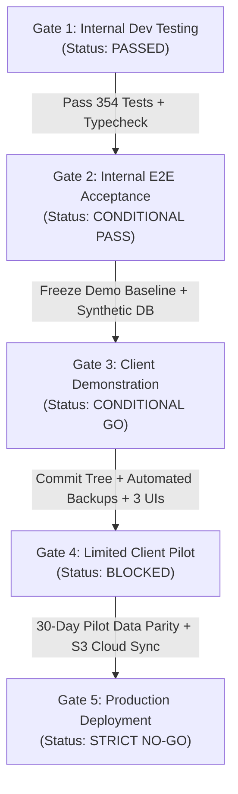
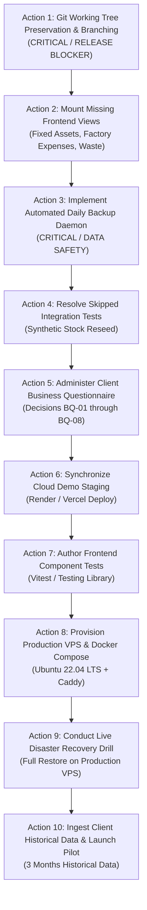

# LIVO FOOTWEAR ERP — NEXT STEPS & RELEASE GATE PLAN

**Document Identifier:** `10_NEXT_STEPS_AND_RELEASE_GATE.md`  
**Audit Directory:** `docs/audit_20261014_093500/`  
**Audit Execution Date:** 2026-10-14 09:35:00 +05:45 (Nepal Standard Time)  
**Objective:** A dependency-aware, disciplined engineering sequence to bring LIVO Footwear ERP from its current audit state through client acceptance and production deployment without risking existing work.

---

## 1. RELEASE GATE CONDITIONS & GO/NO-GO CRITERIA

The path to production is governed by 5 sequential release gates. Progression to the next gate requires satisfying 100% of mandatory conditions.



### Gate 1: Internal Development Testing
- **Status:** **PASSED** (2026-10-14).
- **Mandatory Criteria:**
  - [x] Backend test suite collects and runs cleanly (`pytest backend/tests/ -q`: 354 passed, 3 skipped, 0 failed).
  - [x] Frontend TypeScript AST compiles without errors (`npx tsc --noEmit`: 0 errors).
  - [x] Alembic migration DAG terminates in a single head (`020_fixed_assets_waste_and_expenses`).
  - [x] Multi-tenant isolation verified across 13 penetration tests.

### Gate 2: Internal End-to-End Acceptance
- **Status:** **CONDITIONAL PASS**.
- **Mandatory Criteria:**
  - [x] Procurement Goods Receipt Note (GRN) posting capitalizes 4 landed costs into effective raw material rate.
  - [x] Batch production deduction validates raw material balances and updates finished goods stock atomically.
  - [x] Sales dispatch action decrements footwear physical inventory and prevents duplicate dispatches.
  - [x] Tax invoices enforce mandatory statutory 13% Nepal VAT and allocate atomic sequence numbers.
  - [x] Customer payment receipt allocations reconcile AR subledger aging balances.
  - [x] Worker advances reconcile via FIFO and deduct fixed installments from monthly payroll.
  - [ ] **Condition to Close Gate:** Re-seed test synthetic inventory so the 3 skipped tests in `test_checkpoint_15_query_regression.py` pass without skipping.

### Gate 3: Client Demonstration (Synthetic Data)
- **Status:** **CONDITIONAL GO**.
- **Mandatory Criteria:**
  - [x] Demo environment populated with realistic synthetic footwear data (11 footwear models, 28 production runs, 29 raw material purchases, 30 tax invoices, 15 worker profiles).
  - [x] Real-time bilingual switcher (English / नेपाली) functional across all demonstrated views.
  - [x] Interactive Bikram Sambat datepicker functional on all input forms.
  - [ ] **Demonstration Guardrail:** Demonstrator must stay within the 7 demonstrated views (Dashboard, Stock Ledger, Sales Invoicing, Production Batches, Purchase GRN, AR Aging, HR Profiles) and avoid unmounted modules (Fixed Assets, Factory Expenses, Waste Scrap).

### Gate 4: Limited Client Pilot (Single Factory)
- **Status:** **STRICTLY BLOCKED**.
- **Blockers to Resolve Before Pilot:**
  - [ ] **Blocker 1 (DEF-01):** Working tree must be committed to a formal Git release branch (`release/v1.0.0-pilot`).
  - [ ] **Blocker 2 (DEF-02):** Automated daily backup daemon must be implemented and verified in the live host environment.
  - [ ] **Blocker 3 (DEF-04):** Frontend UI components for Fixed Assets, Factory Expenses, and Waste Management must be built and mounted.
  - [ ] **Blocker 4 (BQ-01/BQ-05):** Factory management must sign off on VAT challan handling and standard monthly worker hours.

### Gate 5: Production Deployment
- **Status:** **STRICTLY NO-GO**.
- **Blockers to Resolve Before Production:**
  - [ ] Successful completion of 30-day single-factory pilot with zero data integrity discrepancies.
  - [ ] Client provisioning of dedicated production VPS and domain DNS delegation for Caddy TLS issuance.
  - [ ] Configuration of offsite S3/B2 encrypted daily backup storage.
  - [ ] Migration execution verified on production cloud PostgreSQL database.

---

## 2. DEPENDENCY-AWARE ACTION SEQUENCE (FIRST 10 ACTIONS)

To complete the ERP safely without losing existing work, execute the following 10 steps in exact dependency order:



### Action 1: Git Working Tree Preservation & Branching (CRITICAL BLOCKER)
- **Objective:** Secure 70 modified tracked files and 44 untracked files against accidental loss.
- **Commands to Propose:**
  ```bash
  git status --short
  git checkout -b release/v1.0.0-phase4b-client-ready
  git add .
  git commit -m "feat: complete Phase 1-4B client change requests, migrations 010-020, and hardening"
  ```
- **Prerequisite:** Completion of this read-only audit.

### Action 2: Mount Missing Frontend Views (Fixed Assets, Factory Expenses, Waste)
- **Objective:** Eliminate the gap between existing backend endpoints and frontend UI.
- **Work Items:**
  1. Author `frontend/src/components/FixedAssetsView.tsx` (consumes `/api/v1/assets`).
  2. Author `frontend/src/components/FactoryExpensesView.tsx` (consumes `/api/v1/expenses/factory`).
  3. Author `frontend/src/components/WasteScrapView.tsx` (consumes `/api/v1/waste`).
  4. Register items in `navItems` array in `frontend/src/components/AppShell.tsx`.
- **Prerequisite:** Action 1 committed.

### Action 3: Implement Automated Daily Backup Daemon
- **Objective:** Eliminate DEF-02 by ensuring backups run unattended daily.
- **Work Items:**
  1. Register an automated async scheduler in `backend/app/main.py` lifespan executing `run_database_backup()` at 02:00 NPT daily.
  2. Create an `/etc/systemd/system/livo-backup.timer` definition in `scripts/deployment/`.
  3. Clean up the 150+ 35-byte mocked `.sql` files from `backend/backups/`.
- **Prerequisite:** Action 1 committed.

### Action 4: Resolve Skipped Integration Tests in Query Regression Suite
- **Objective:** Achieve 100% passing tests (357 of 357 passing, 0 skipped).
- **Work Items:** Update fixture seeding in `backend/tests/test_checkpoint_15_query_regression.py` to ensure synthetic stock balance is sufficient for simulated sales volume.
- **Prerequisite:** Action 1 committed.

### Action 5: Administer Client Business Questionnaire (BQ-01 to BQ-08)
- **Objective:** Obtain formal client decisions on VAT challan handling, monthly worker hour bases, and backup storage destination.
- **Deliverable:** Completed decision register signed off by client.

### Action 6: Synchronize Cloud Demo Staging Environment
- **Objective:** Bring `https://livo-footwear-erp.vercel.app` into complete synchronization with local codebase.
- **Work Items:**
  1. Push `release/v1.0.0-phase4b-client-ready` to GitHub origin.
  2. Apply Alembic migrations 010–020 against Render PostgreSQL database (`alembic upgrade head`).
  3. Trigger Next.js production build deployment on Vercel.

### Action 7: Author Frontend Component Test Suite
- **Objective:** Establish automated regression testing for React components.
- **Work Items:** Set up Vitest; write tests for `NepaliDatePicker.tsx`, `offlineQueue.ts`, and financial utility formatting.

### Action 8: Provision Dedicated Production VPS & Docker Compose
- **Objective:** Deploy production environment on Ubuntu 22.04 LTS VPS with Caddy auto-TLS.
- **Work Items:** Execute `docs/PRODUCTION_DEPLOYMENT_RUNBOOK.md` on provisioned host; configure domain DNS A-record.

### Action 9: Conduct Live Disaster Recovery Drill on Production PostgreSQL
- **Objective:** Prove production restore capability per PRD §4.
- **Work Items:** Take live `pg_dump` of production schema and test data; execute full restore to a secondary test database; verify financial ledger parity.

### Action 10: Ingest Client Historical Data & Launch Limited Pilot
- **Objective:** Migrate client's ~3 months of historical factory records and commence live single-factory pilot.
- **Work Items:** Build CSV ingestion script for historical vendor ledgers, worker advance balances, and opening finished-goods inventory.
