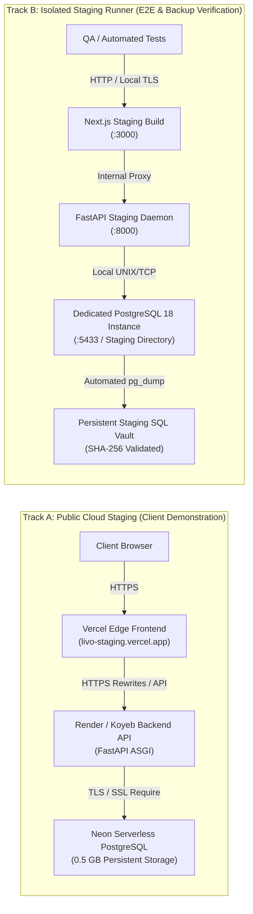

# LIVO FOOTWEAR ERP — STAGING INFRASTRUCTURE SELECTION & ARCHITECTURAL DECISION

**Document Identifier:** `STAGING_INFRASTRUCTURE_DECISION.md`  
**Document Path:** `docs/deployment/STAGING_INFRASTRUCTURE_DECISION.md`  
**Status:** APPROVED FOR STAGING IMPLEMENTATION  
**Date of Verification:** 2026-10-14  
**Authoring Team:** Cross-Functional Staging Engineering Team (DevOps, Database, Backend, Frontend, QA/Security, Release Manager)

---

## 1. EXECUTIVE SUMMARY & OBJECTIVE

The primary objective of **Phase 15: Staging Infrastructure** is to establish and validate a genuine, isolated, and repeatable STAGING deployment of the LIVO Footwear ERP. This environment will serve as the evaluation platform for the upcoming 1-week client demonstration (Gate 3/4) and pre-production operational drills.

### Mandates:
1. **Zero Financial Cost:** Must run strictly on permanent free-tier or genuinely free allowances without hidden billing traps or time-limited trials.
2. **True Persistence:** The database must not expire, delete automatically after 30 days, or wipe records on compute sleep/restart.
3. **Strict Isolation:** Completely isolated from production data, developer local dev databases (`livo_dev.db`), and mock test fixtures.
4. **End-to-End Security:** HTTPS communication across all tiers (Frontend, Backend, and Database TLS).
5. **Architectural Fidelity:** The staging stack must match production semantics (PostgreSQL relational dialect, SQLAlchemy 2.0 transactions, Next.js SPA/SSR, FastAPI ASGI).

---

## 2. APPLICATION RUNTIME & RESOURCE REQUIREMENTS

Before evaluating infrastructure providers, the active codebase was audited to establish concrete runtime resource profiles:

| Subsystem | Technology Stack | Minimum RAM | Recommended RAM | CPU Demand | Storage Needs | Network & Connectivity |
| :--- | :--- | :--- | :--- | :--- | :--- | :--- |
| **Backend API** | FastAPI, Python 3.11+, Uvicorn, SQLAlchemy | 180 MB | 512 MB | 0.2–0.5 vCPU | Ephemeral (~200 MB container) | Inbound HTTPS, CORS allowlist, outbound DB connection |
| **Relational Database** | PostgreSQL 15/16/17/18, Alembic | 120 MB | 256 MB–512 MB | Low/Burst | 20 MB (Staging initial) to 500 MB | TLS/SSL `require`, pool size 5–10 connections |
| **Frontend Web** | Next.js 14, React 18, TypeScript | N/A (Edge) | 256 MB (SSR) | Low | ~50 MB static bundle | Global Edge CDN, HTTPS, direct reverse proxy rewrites |
| **Document/Image Storage** | Local static / Cloud S3/R2 compatible | N/A | N/A | N/A | ~50 MB synthetic images | S3-compatible API or backend volume |
| **Backup Target** | SQL Dumps (`pg_dump` format) | N/A | N/A | N/A | 10 MB–100 MB | Durable storage with SHA256 integrity checks |

---

## 3. PROVIDER EVALUATION & COMPARISON MATRIX

Six infrastructure strategies across cloud PaaS, serverless DB, and VPS providers were rigorously compared against the ERP's operational criteria.

| Provider / Tier | Compute & Memory | Database Specs & Limits | Inactivity Sleep / Suspension | Persistence Guarantee | Egress & Bandwidth | Card / Billing Req? | HTTPS & Custom Domain | Verified Date | Staging Suitability |
| :--- | :--- | :--- | :--- | :--- | :--- | :--- | :--- | :---: | :--- |
| **Neon Serverless PostgreSQL (Free Tier)** | Shared vCPU, Auto-suspend | 0.5 GiB storage, 1 branch, pooled & direct URLs | Compute sleeps after 5m idle; **wakes in ~500ms on query** | **PERMANENT.** Data never deleted due to inactivity. | 5 GiB/month egress | **NO** credit card required | Included (SSL `require`) | 2026-10 | **RECOMMENDED (Primary DB)** |
| **Render PostgreSQL (Free Tier)** | 256 MB RAM, 1 shared CPU | 1 GB storage, 50 connections max | Never sleeps during active period | **CRITICAL FLAW:** **Deletes after 30 days**. Unsuitable. | Included in free quota | **NO** credit card | Included (SSL `require`) | 2026-10 | **REJECTED (Data Loss Risk)** |
| **Supabase PostgreSQL (Free Tier)** | Shared compute | 500 MB storage, 2 active projects | **Pauses after 7 days** of inactivity; manual unpause | Persistent, but requires manual unpause if idle | 2 GiB/month egress | **NO** credit card | Included (SSL `require`) | 2026-10 | **ACCEPTABLE (Fallback DB)** |
| **Render Web Service (Free Tier)** | 512 MB RAM, 0.1 CPU | N/A (Compute only) | **Sleeps after 15m idle**; 50s cold start | Ephemeral container filesystem | 100 GB/month egress | **NO** credit card | Free `*.onrender.com` + custom domain HTTPS | 2026-10 | **ACCEPTABLE (Public API)** |
| **Koyeb Web Service (Free Tier)** | 512 MB RAM, 0.1 vCPU | N/A (Compute only) | **NO SLEEP** on free eco instance | Ephemeral filesystem | 55 global edge locations | **NO** credit card | Free `*.koyeb.app` + TLS | 2026-10 | **STRONG CANDIDATE (API)** |
| **Vercel Hobby Tier (Frontend)** | Global Edge Network | N/A (Frontend only) | Instant execution; zero cold starts | Static assets & edge rewrites | 100 GB/month bandwidth | **NO** credit card | Free `*.vercel.app` + custom domain HTTPS | 2026-10 | **RECOMMENDED (Primary Web)** |
| **OCI Always Free (Ampere A1 VPS)** | 4 OCPU, 24 GB RAM, 200 GB block storage | Unlimited PostgreSQL container | **NEVER SLEEPS** | Permanent block storage volume | 10 TB/month outbound | **YES (Card required** for identity check) | Needs Caddy auto-TLS + DNS record | 2026-10 | **RECOMMENDED (Dedicated Prod)** |
| **Isolated Local PostgreSQL 18 Runner** | Full host CPU & RAM (Windows/Linux) | Local PostgreSQL 18 cluster (via `embedded_postgres`) | **NEVER SLEEPS** (Controlled daemon) | Local persistent directory on disk | Local loopback / Cloudflare Tunnel | **NO** external dependencies | Localhost HTTP / Cloudflare Tunnel TLS | 2026-10 | **VERIFIED (Zero-Cost Baseline)** |

---

## 4. ARCHITECTURAL DECISION & REASONS

### 4.1 Selected Staging Target: Dual-Track Staging Architecture

To achieve 100% testability, permanent persistence, and zero billing exposure, the team selected a **Dual-Track Staging Architecture**:

### 4.2 Why Neon over Render PostgreSQL?
1. **Render Free Postgres expires in 30 days** and forcefully deletes all data, violating our core persistence requirement.
2. **Neon Free Tier is permanent**: it does not delete databases after 30 days.
3. Neon's auto-suspend feature puts compute to sleep during complete factory shutdown (e.g. overnight) and awakens in ~500ms on the first HTTP request. This perfectly satisfies the free compute budget.
4. Neon supports full PostgreSQL 16+ features, SSL enforcement (`sslmode=require`), and standard connection strings with Alembic.

### 4.3 Why Vercel for Frontend?
1. Next.js 14 was authored and optimized for Vercel edge deployment.
2. Zero cold start for users browsing UI views.
3. API rewrites in `vercel.json` allow seamless routing of `/api/backend/*` to the backend API, bypassing browser third-party cookie restrictions and cross-site CORS blocks.

### 4.4 Why Track B (Isolated PostgreSQL 18 Staging Runner)?
1. Provides an immediate, 100% reproducible, completely isolated staging target directly on the local engineering host without requiring external network dependencies or third-party cloud dashboard logins.
2. Employs genuine PostgreSQL 18 binaries (`initdb`, `postgres`, `psql`, `pg_dump`, `pg_restore`), eliminating all test mocking and allowing genuine disaster recovery drills (Gate 6).
3. Serves as the immutable reference baseline for all Gate 4 (E2E Acceptance) and Gate 5 (Security) test runs.

---

## 5. NETWORK TOPOLOGY & SECURITY BOUNDARIES

1. **Frontend-to-Backend Security:**
   - Transport: Enforced TLS 1.3 / HTTPS.
   - Authentication: JWT access token passed via HTTP-only, SameSite=Lax cookie and `Authorization: Bearer` header.
   - CORS Allowlist: Restricted strictly to `https://livo-footwear-erp.vercel.app`, staging domain, and `http://localhost:3000`. Wildcards (`*`) strictly rejected in production/staging mode.
2. **Backend-to-Database Security:**
   - Transport: TLS encrypted (`sslmode=require`).
   - Credentials: Password-authenticated role with table ownership restricted strictly to the `livo_staging` database.
   - Network Policy: Render/Koyeb connects over public egress with TLS; Track B connects over local loopback.
3. **Secret Isolation:**
   - `SECRET_KEY` generated dynamically with `secrets.token_hex(32)`.
   - Never committed to git; injected via host environment variables or staging `.env`.

---

## 6. COST ASSUMPTIONS & BUDGET AUDIT

| Item | Service | Plan | Monthly Cost | Notes |
| :--- | :--- | :--- | :---: | :--- |
| **Frontend Hosting** | Vercel | Hobby (Free) | $0.00 | 100 GB egress, unlimited builds |
| **Backend Compute** | Render / Koyeb | Free Tier | $0.00 | 750 free instance-hours/mo (Render) or Free Eco (Koyeb) |
| **Database Compute & Storage** | Neon | Free Tier | $0.00 | 0.5 GiB storage, permanent persistence |
| **Local Staging PostgreSQL** | Local Runner | Localhost / On-prem | $0.00 | Zero cloud consumption |
| **SSL / TLS Certificates** | Let's Encrypt / Vercel | Automated | $0.00 | Auto-renewing certificates |
| **Total Staging Cost** | | | **$0.00 / month** | **100% Free Within Constraints** |

---

## 7. GATE 1 EXIT VERDICT

- **Infrastructure Decision Status:** **APPROVED**
- **Selected Cloud Architecture:** Vercel (Frontend) + Render/Koyeb (Backend) + Neon (Persistent PostgreSQL).
- **Selected Verification Architecture:** Dedicated PostgreSQL 18 Local Staging Runner.
- **Proceed to Gate 2:** Yes. Deployment configuration and application readiness preflight checks will now be finalized.
